<p align="center"><picture><source media="(prefers-color-scheme: dark)" srcset="diagrams/banners/hero-dark.svg">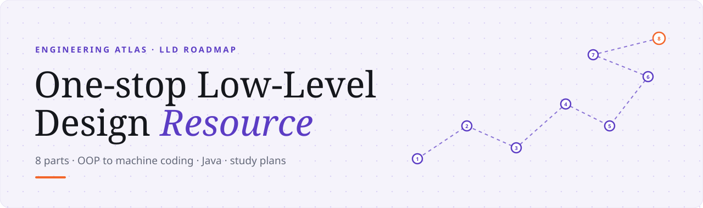</picture></p>

<h1 align="center">One-stop Low-Level Design Resource</h1>

<p align="center"><b>Learn low-level design (LLD) in the right order: OOP, SOLID, design patterns, UML, concurrency and machine coding problems, with Java examples.</b></p>

<p align="center">


<a href="https://www.linkedin.com/company/engineering-atlas/"></a>
</p>

<p align="center">
<a href="#part-i-getting-started"><picture><source media="(prefers-color-scheme: dark)" srcset="diagrams/banners/btn-start-dark.svg"></picture></a>&nbsp;
<a href="#pick-your-plan"><picture><source media="(prefers-color-scheme: dark)" srcset="diagrams/banners/btn-plan-dark.svg"></picture></a>&nbsp;
<a href="#part-vii-lld-interview-questions-with-solutions"><picture><source media="(prefers-color-scheme: dark)" srcset="diagrams/banners/btn-problems-dark.svg"></picture></a>
</p>

<p align="center"><a href="#part-vii-lld-interview-questions-with-solutions"><picture><source media="(prefers-color-scheme: dark)" srcset="diagrams/tags/questions-dark.svg"></picture></a></p>

<p align="center"><a href="https://engineering-atlas.in/?utm_source=github&utm_medium=lld-roadmap&utm_campaign=readme"></a>&nbsp;&nbsp;&nbsp;<a href="https://www.linkedin.com/company/engineering-atlas/"></a><br><sub>© 2026 Engineering Atlas · <a href="https://creativecommons.org/licenses/by-nc-sa/4.0/">CC BY-NC-SA 4.0</a> · Share with credit, not for commercial use</sub></p>

## What is low-level design?

Low-level design is deciding how the code inside one service is organised: which classes exist, what each one is responsible for, how they talk to each other, and how the design copes when requirements change. The output is a class diagram and working code.

A design is good when it is correct, easy to read and easy to extend: a new requirement should mean a new class, not a rewrite. That is also what an LLD or machine coding round checks.

> [!NOTE]
> **LLD vs HLD.** Low-level design (this guide) is about classes and code inside one service. High-level design is about services, databases and how they talk across machines. For that side, see the companion repo, [One-stop System Design Resource](https://github.com/abhishekgoyal17/one-stop-system-design-resource).

## Start with the core concepts

Most LLD rounds test the same twelve ideas. Learn these first; each one jumps to its chapter, which links to the full lesson on Engineering Atlas.

| | | |
|---|---|---|
| **01 · [Classes and interfaces](#03-classes-objects-enums-and-interfaces)**<br>Model the nouns<br><sub>Chapter 03</sub> | **02 · [Four pillars of OOP](#04-the-four-pillars-of-oop)**<br>Encapsulate, abstract, inherit, vary<br><sub>Chapter 04</sub> | **03 · [Class relationships](#05-class-relationships)**<br>Has-a, is-a, uses<br><sub>Chapter 05</sub> |
| **04 · [SOLID](#08-solid-principles)**<br>Five rules for change<br><sub>Chapter 08</sub> | **05 · [Composition over inheritance](#07-coupling-cohesion-and-composition)**<br>Build from parts<br><sub>Chapter 07</sub> | **06 · [Class diagrams](#09-class-diagrams)**<br>Draw it before coding<br><sub>Chapter 09</sub> |
| **07 · [Creational patterns](#11-creational-patterns)**<br>Factory, Builder, Singleton<br><sub>Chapter 11</sub> | **08 · [Structural patterns](#12-structural-patterns)**<br>Adapter, Decorator, Facade<br><sub>Chapter 12</sub> | **09 · [Behavioural patterns](#13-behavioural-patterns-the-everyday-six)**<br>Strategy, Observer, State<br><sub>Chapter 13</sub> |
| **10 · [Thread safety](#16-threads-and-race-conditions)**<br>Races, locks, atomics<br><sub>Chapter 16</sub> | **11 · [Producer-consumer](#19-executors-and-producer-consumer)**<br>Queues and executors<br><sub>Chapter 19</sub> | **12 · [The interview method](#21-the-method-and-the-clock)**<br>Requirements to code<br><sub>Chapter 21</sub> |

## How to use this roadmap

1. **Pick a plan** that fits your time (below).
2. **Follow the parts in order.** Read the short explanation, then the lesson or free read when you want depth.
3. **Write the code.** Every chapter has a "Try this" task. Patterns you have typed stick; patterns you have only read don't.
4. **Test yourself.** Each part ends with "Can you answer these?" If you can answer them out loud, move on.

New to this? Start at Part I. Interview soon? Pick a plan below. Experienced? Read each chapter's "ready to move on" line and stop where you can't answer it.

Each topic carries a level: <picture><source media="(prefers-color-scheme: dark)" srcset="diagrams/tags/beginner-dark.svg"></picture> <picture><source media="(prefers-color-scheme: dark)" srcset="diagrams/tags/intermediate-dark.svg"></picture> <picture><source media="(prefers-color-scheme: dark)" srcset="diagrams/tags/advanced-dark.svg"></picture>. Topics without a link are lessons still being written.

### Track your prep

Each part moves you closer to interview ready. The weights follow how often each part comes up in real rounds, so patterns and practice problems count for more.

| When you finish | You are about |
|---|---|
| Part I: Getting started |  |
| Part II: OOP foundations |  |
| Part III: Design principles |  |
| Part IV: UML |  |
| Part V: Design patterns |  |
| Part VI: Concurrency |  |
| Part VII: Practice problems |  |
| Part VIII: The interview |  |

## Roadmap at a glance

<p align="center">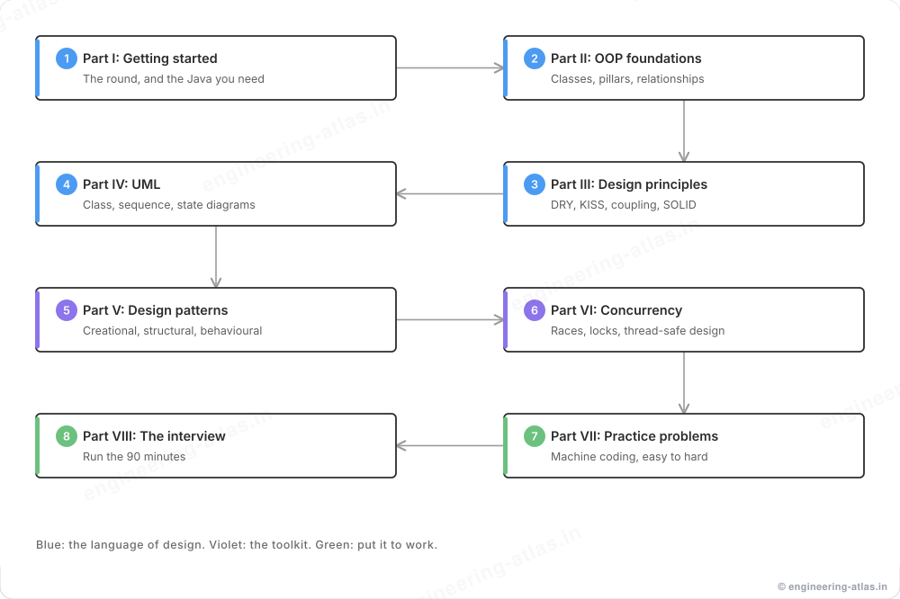</p>

| Part | What you learn | Start here |
|---|---|---|
| [I. Getting started](#part-i-getting-started) | What the round is, and the Java you need | 01 What LLD is |
| [II. OOP foundations](#part-ii-object-oriented-foundations) | Classes, the four pillars, relationships | 03 Classes and interfaces |
| [III. Design principles](#part-iii-design-principles) | DRY, KISS, YAGNI, coupling, SOLID | 08 SOLID |
| [IV. UML](#part-iv-uml-for-interviews) | Class, sequence and state diagrams | 09 Class diagrams |
| [V. Design patterns](#part-v-design-patterns) | Creational, structural, behavioural and beyond | 13 The everyday six |
| [VI. Concurrency](#part-vi-concurrency-for-lld) | Races, locks, atomics, thread-safe design | 16 Race conditions |
| [VII. Interview questions with solutions](#part-vii-lld-interview-questions-with-solutions) | Easy to hard machine coding problems | Parking lot |
| [VIII. The interview](#part-viii-the-lld-interview) | Running the 90 minutes | 21 The method |

## Contents

<details>
<summary><b>Open the full table of contents</b> (every part and chapter)</summary>

- [Part I: Getting started](#part-i-getting-started)
  - [01. What Low-Level Design Is](#01-what-low-level-design-is)
  - [02. The Java You Need for LLD](#02-the-java-you-need-for-lld)
- [Part II: Object-oriented foundations](#part-ii-object-oriented-foundations)
  - [03. Classes, Objects, Enums and Interfaces](#03-classes-objects-enums-and-interfaces)
  - [04. The Four Pillars of OOP](#04-the-four-pillars-of-oop)
  - [05. Class Relationships](#05-class-relationships)
- [Part III: Design principles](#part-iii-design-principles)
  - [06. Everyday Design Principles](#06-everyday-design-principles)
  - [07. Coupling, Cohesion and Composition](#07-coupling-cohesion-and-composition)
  - [08. SOLID Principles](#08-solid-principles)
- [Part IV: UML for interviews](#part-iv-uml-for-interviews)
  - [09. Class Diagrams](#09-class-diagrams)
  - [10. Behaviour Diagrams](#10-behaviour-diagrams)
- [Part V: Design patterns](#part-v-design-patterns)
  - [11. Creational Patterns](#11-creational-patterns)
  - [12. Structural Patterns](#12-structural-patterns)
  - [13. Behavioural Patterns: the Everyday Six](#13-behavioural-patterns-the-everyday-six)
  - [14. Behavioural Patterns: the Specialists](#14-behavioural-patterns-the-specialists)
  - [15. Patterns Beyond the Classic 23](#15-patterns-beyond-the-classic-23)
- [Part VI: Concurrency for LLD](#part-vi-concurrency-for-lld)
  - [16. Threads and Race Conditions](#16-threads-and-race-conditions)
  - [17. Locks and Visibility](#17-locks-and-visibility)
  - [18. Atomics and Concurrent Collections](#18-atomics-and-concurrent-collections)
  - [19. Executors and Producer-Consumer](#19-executors-and-producer-consumer)
  - [20. Designing Thread-safe Classes](#20-designing-thread-safe-classes)
- [Part VII: LLD interview questions with solutions](#part-vii-lld-interview-questions-with-solutions)
  - [Easy problems](#easy-problems)
  - [Medium problems](#medium-problems)
  - [Hard problems](#hard-problems)
  - [Solution outlines for six classic problems](#solution-outlines-for-six-classic-problems)
- [Part VIII: The LLD interview](#part-viii-the-lld-interview)
  - [21. The Method and the Clock](#21-the-method-and-the-clock)
  - [22. From Requirements to Code](#22-from-requirements-to-code)
  - [23. What Reviewers Grade, and Common Mistakes](#23-what-reviewers-grade-and-common-mistakes)
  - [24. Testing Your Design](#24-testing-your-design)
- [How to answer an LLD interview question](#how-to-answer-an-lld-interview-question)
- [Appendix: cheat sheets](#appendix-cheat-sheets)
- [Glossary](#glossary)
- [Books and free resources](#books-and-free-resources)
- [Why Engineering Atlas](#why-engineering-atlas)
- [Contributing and licence](#contributing-and-licence)

</details>

## Pick your plan

Hours are a realistic weekly budget next to a full-time job. Chapter numbers point into the roadmap below.

<details open>
<summary><b>2-week crash plan</b> &nbsp;<sub>about 10 hours a week, interview first</sub></summary>

| Week | Read | Practise |
|---|---|---|
| 1 | 01, 04, 05, 08, then 11 to 13 | Parking lot, LRU cache, vending machine |
| 2 | 16, 18, 20, then Part VIII | Elevator, movie booking, one timed 90-minute mock |

</details>

<details>
<summary><b>6-week plan</b> &nbsp;<sub>about 8 hours a week, interview ready</sub></summary>

| Week | Read | Practise |
|---|---|---|
| 1 | Part I and II (01 to 05) | Tic-tac-toe, logging framework |
| 2 | Part III and IV (06 to 10) | Parking lot with a class diagram first |
| 3 | 11 to 13 | Vending machine, LRU cache, notification system |
| 4 | 14, 15, then 16 to 18 | Library management, movie booking |
| 5 | 19, 20, then Part VIII | Elevator, rate limiter, car rental |
| 6 | Revisit weak chapters | Splitwise, chess, two timed mocks |

</details>

<details>
<summary><b>12-week plan</b> &nbsp;<sub>about 6 hours a week, deep and complete</sub></summary>

| Week | Read | Practise |
|---|---|---|
| 1 | 01, 02 | Write five small value classes and records |
| 2 | 03 to 05 | Model a school and a coffee menu |
| 3 | 06, 07 | Refactor one inheritance tree to composition |
| 4 | 08 | One SOLID refactor per principle |
| 5 | 09, 10 | Tic-tac-toe, snake and ladder with diagrams |
| 6 | 11, 12 | Logging framework, in-memory file system |
| 7 | 13 | Vending machine, notification system |
| 8 | 14, 15 | Library management, task management |
| 9 | 16 to 18 | Make the parking lot thread-safe |
| 10 | 19, 20 | Movie booking, rate limiter, pub-sub |
| 11 | 21 to 23 | Elevator, car rental, mock round 1 |
| 12 | 24, revisit weak chapters | Splitwise, chess, mock round 2 |

</details>

## Pick your path by background

<table>
<tr><td width="50%"><a href="#part-i-getting-started"><picture><source media="(prefers-color-scheme: dark)" srcset="diagrams/banners/card-beginner-dark.svg">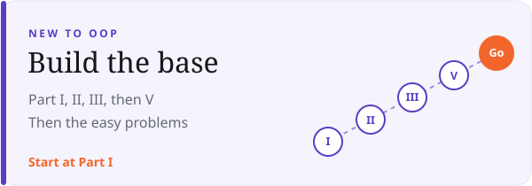</picture></a></td><td width="50%"><a href="#part-iii-design-principles"><picture><source media="(prefers-color-scheme: dark)" srcset="diagrams/banners/card-refresh-dark.svg">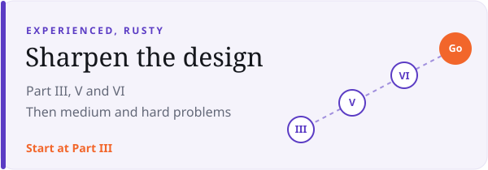</picture></a></td></tr>
<tr><td width="50%"><a href="#part-v-design-patterns"><picture><source media="(prefers-color-scheme: dark)" srcset="diagrams/banners/card-interview-dark.svg">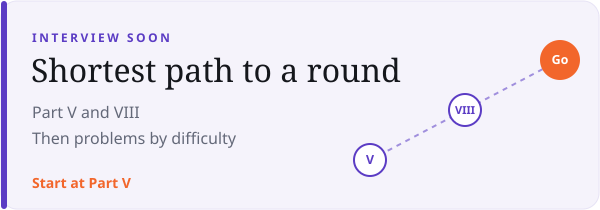</picture></a></td><td width="50%"><a href="#part-vi-concurrency-for-lld"><picture><source media="(prefers-color-scheme: dark)" srcset="diagrams/banners/card-deep-dark.svg">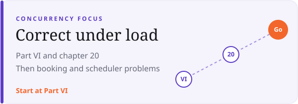</picture></a></td></tr>
</table>


---

## Part I: Getting started

<p align="center"><picture><source media="(prefers-color-scheme: dark)" srcset="diagrams/banners/part-1-dark.svg">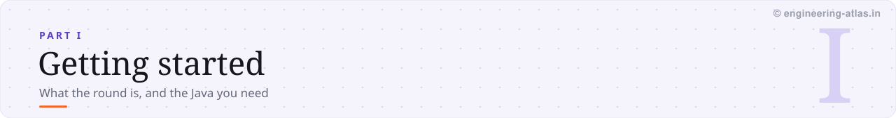</picture></p>

*Know what the round is before you prepare for it.* Low-level design rounds are scored very differently from DSA rounds. This part tells you what you are building, what the interviewer writes down, and the Java you need to have ready.

### 01. What Low-Level Design Is

<picture><source media="(prefers-color-scheme: dark)" srcset="diagrams/banners/ch-01-dark.svg"></picture>

<a href="https://engineering-atlas.in/lld/introduction/?utm_source=github&utm_medium=lld-roadmap&utm_campaign=lld-introduction"><picture><source media="(prefers-color-scheme: dark)" srcset="diagrams/banners/btn-chapter-dark.svg"></picture></a>

| | |
|---|---|
| **Why know this** | Most people fail their first LLD round because they treat it like a DSA problem: one clever algorithm, written fast. The round rewards something else: clear classes, sensible names, and code that is easy to change when the interviewer adds a requirement. |
| **What interviewers test** | Do you know what this round scores, and do you start with requirements instead of code? |
| **What you will cover** | What is low-level design? · LLD vs DSA vs HLD · Types of LLD interviews · What interviewers score · How to learn LLD |
| **Try this** | Take "design a library system" and write, in five minutes, how the LLD, HLD and DSA versions of that question would differ. |
| **Ready to move on when** | You can say in two sentences how an LLD round differs from a DSA round and from a system design round, and name three things the interviewer scores. |


| Topic | What it is, and why it matters | Free read |
|---|---|---|
| <a href="https://engineering-atlas.in/lld/introduction/what-is-low-level-design/?utm_source=github&utm_medium=lld-roadmap&utm_campaign=lld-what-is-low-level-design">What is low-level design?</a><br><picture><source media="(prefers-color-scheme: dark)" srcset="diagrams/tags/beginner-dark.svg"></picture> | Turning a feature into classes, interfaces and methods that work together. The output is a class diagram and working code, not boxes and arrows between servers. |  |
| <a href="https://engineering-atlas.in/lld/introduction/lld-vs-dsa-vs-hld/?utm_source=github&utm_medium=lld-roadmap&utm_campaign=lld-lld-vs-dsa-vs-hld">LLD vs DSA vs HLD</a><br><picture><source media="(prefers-color-scheme: dark)" srcset="diagrams/tags/beginner-dark.svg"></picture> | DSA asks for the fastest correct algorithm. HLD asks how services and data stores fit across machines. LLD asks how the code inside one service is organised so it stays correct as it grows. |  |
| <a href="https://engineering-atlas.in/lld/introduction/types-of-lld-interviews/?utm_source=github&utm_medium=lld-roadmap&utm_campaign=lld-types-of-lld-interviews">Types of LLD interviews</a><br><picture><source media="(prefers-color-scheme: dark)" srcset="diagrams/tags/beginner-dark.svg"></picture> | Machine coding (90 minutes, runnable code), a design discussion (class diagram and key methods on a whiteboard), or a review of code you wrote earlier. Each one needs a slightly different plan. |  |
| <a href="https://engineering-atlas.in/lld/introduction/what-interviewers-score/?utm_source=github&utm_medium=lld-roadmap&utm_campaign=lld-what-interviewers-score">What interviewers score</a><br><picture><source media="(prefers-color-scheme: dark)" srcset="diagrams/tags/beginner-dark.svg"></picture> | Working code first, then clean entities, sensible use of interfaces, extensibility when a new requirement arrives, and how well you explain your choices. |  |
| <a href="https://engineering-atlas.in/lld/introduction/how-to-learn-lld/?utm_source=github&utm_medium=lld-roadmap&utm_campaign=lld-how-to-learn-lld">How to learn LLD</a><br><picture><source media="(prefers-color-scheme: dark)" srcset="diagrams/tags/beginner-dark.svg"></picture> | OOP and principles first, then patterns, then problems. Patterns learned without problems are trivia; problems solved without principles turn into one huge class. |  |


### 02. The Java You Need for LLD

<picture><source media="(prefers-color-scheme: dark)" srcset="diagrams/banners/ch-02-dark.svg"></picture>

<a href="https://engineering-atlas.in/java/core-java/?utm_source=github&utm_medium=lld-roadmap&utm_campaign=java-core-java"><picture><source media="(prefers-color-scheme: dark)" srcset="diagrams/banners/btn-chapter-dark.svg"></picture></a>

| | |
|---|---|
| **Why know this** | Interviewers notice when the language fights you. You don't need advanced Java, but you do need to write a clean class, pick the right collection and override `equals` and `hashCode` without looking anything up. |
| **What interviewers test** | Can you write clean Java classes, pick the right collection and avoid equals and hashCode bugs? |
| **What you will cover** | The Java LLD rulebook · Access modifiers · The equals() and hashCode() contracts · Designing immutable objects · Records in Java · Choosing the right collection · Custom exceptions and best practices |
| **Try this** | Write an immutable `Money` record with an amount and a currency. Add it to a `HashSet` twice and check there is only one entry. |
| **Ready to move on when** | You can write an immutable value class, choose between `HashMap`, `TreeMap` and `LinkedHashMap` for a use case, and explain why a broken `hashCode` loses entries in a `HashSet`. |


| Topic | What it is, and why it matters | Free read |
|---|---|---|
| <a href="https://engineering-atlas.in/java/java-lld-rulebook?utm_source=github&utm_medium=lld-roadmap&utm_campaign=java-java-lld-rulebook">The Java LLD rulebook</a><br><picture><source media="(prefers-color-scheme: dark)" srcset="diagrams/tags/beginner-dark.svg"></picture> | A short list of Java habits that make LLD code read well: private fields, constructor injection, enums for fixed sets, and interfaces at the seams. |  |
| <a href="https://engineering-atlas.in/java/fundamentals/access-modifiers/?utm_source=github&utm_medium=lld-roadmap&utm_campaign=java-access-modifiers">Access modifiers</a><br><picture><source media="(prefers-color-scheme: dark)" srcset="diagrams/tags/beginner-dark.svg"></picture> | `private` by default, package-private for helpers, `public` only for the methods other classes must call. The modifiers are how Java enforces encapsulation for you. |  |
| <a href="https://engineering-atlas.in/java/core-java/the-equals-and-hashcode-contracts/?utm_source=github&utm_medium=lld-roadmap&utm_campaign=java-the-equals-and-hashcode-contracts">The equals() and hashCode() contracts</a><br><picture><source media="(prefers-color-scheme: dark)" srcset="diagrams/tags/intermediate-dark.svg"></picture> | Two equal objects must have the same hash code. Break that and maps and sets quietly lose your objects, which shows up as a bug far from the cause. |  |
| <a href="https://engineering-atlas.in/java/core-java/designing-immutable-objects/?utm_source=github&utm_medium=lld-roadmap&utm_campaign=java-designing-immutable-objects">Designing immutable objects</a><br><picture><source media="(prefers-color-scheme: dark)" srcset="diagrams/tags/intermediate-dark.svg"></picture> | Final fields, no setters, defensive copies of mutable inputs. Immutable objects are safe to share between threads and easy to reason about. |  |
| <a href="https://engineering-atlas.in/java/core-java/records-in-java/?utm_source=github&utm_medium=lld-roadmap&utm_campaign=java-records-in-java">Records in Java</a><br><picture><source media="(prefers-color-scheme: dark)" srcset="diagrams/tags/beginner-dark.svg"></picture> | A one-line immutable data class with `equals`, `hashCode` and `toString` written for you. Ideal for value objects like `Money` or `Position`. |  |
| <a href="https://engineering-atlas.in/java/collections/choosing-the-right-collection/?utm_source=github&utm_medium=lld-roadmap&utm_campaign=java-choosing-the-right-collection">Choosing the right collection</a><br><picture><source media="(prefers-color-scheme: dark)" srcset="diagrams/tags/intermediate-dark.svg"></picture> | List for order, Set for uniqueness, Map for lookup, Deque for queues and stacks. Then pick the implementation by what you do most: get, insert, iterate in order or sort. |  |
| <a href="https://engineering-atlas.in/java/core-java/custom-exceptions-and-best-practices/?utm_source=github&utm_medium=lld-roadmap&utm_campaign=java-custom-exceptions-and-best-practices">Custom exceptions and best practices</a><br><picture><source media="(prefers-color-scheme: dark)" srcset="diagrams/tags/intermediate-dark.svg"></picture> | Throw a named exception like `SlotNotAvailableException` instead of returning `null` or `-1`. The caller sees what went wrong, and your design reads better. | <a href="https://docs.oracle.com/javase/tutorial/essential/exceptions/index.html">Oracle Java tutorial: Exceptions</a> |


### Can you answer these?

1. What does an LLD interviewer want to see in the first 10 minutes?
2. Why is a 400-line `ParkingLot` class a bad sign even if it passes every test?
3. When would you use a `record` instead of a class?
4. What breaks if you override `equals` but not `hashCode`?

**Continue learning on Engineering Atlas:** [LLD course: Start here](https://engineering-atlas.in/lld/introduction/?utm_source=github&utm_medium=lld-roadmap&utm_campaign=lld-introduction)

<p align="right"><sub><a href="#contents">Back to contents ↑</a></sub></p>

## Part II: Object-oriented foundations

<p align="center"><picture><source media="(prefers-color-scheme: dark)" srcset="diagrams/banners/part-2-dark.svg">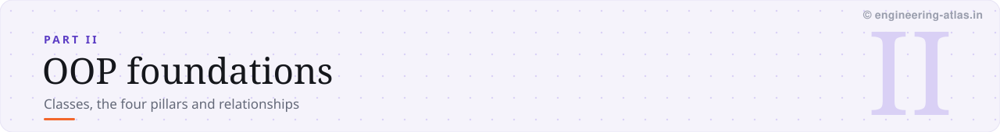</picture></p>

*Every pattern and every problem in this guide is built from these ideas.* Learn them with small examples you could write from memory, because you will explain them out loud in the round.

### 03. Classes, Objects, Enums and Interfaces

<picture><source media="(prefers-color-scheme: dark)" srcset="diagrams/banners/ch-03-dark.svg"></picture>

<a href="https://engineering-atlas.in/lld/oop-fundamentals/?utm_source=github&utm_medium=lld-roadmap&utm_campaign=lld-oop-fundamentals"><picture><source media="(prefers-color-scheme: dark)" srcset="diagrams/banners/btn-chapter-dark.svg"></picture></a>

| | |
|---|---|
| **Why know this** | These are the four tools you will reach for in every design. Knowing when a concept should be a class, an enum or an interface decides whether your model is clean from the first minute. |
| **What interviewers test** | Do you model fixed sets as enums, contracts as interfaces and things with state as classes? |
| **What you will cover** | Classes and objects · Enums · Interfaces |
| **Try this** | Model a coffee menu: drink sizes as an enum with a price multiplier, and drinks behind a `Drink` interface. |
| **Ready to move on when** | You can look at a requirement like "vehicles can be cars, bikes or trucks" and say whether it is an enum, a class hierarchy or an interface, and why. |


| Topic | What it is, and why it matters | Free read |
|---|---|---|
| <a href="https://engineering-atlas.in/lld/oop-fundamentals/classes-and-objects/?utm_source=github&utm_medium=lld-roadmap&utm_campaign=lld-classes-and-objects">Classes and objects</a><br><picture><source media="(prefers-color-scheme: dark)" srcset="diagrams/tags/beginner-dark.svg"></picture> | A class bundles data with the methods that change it. An object is one instance with its own state. Good classes are nouns from the problem: `Ticket`, `Slot`, `Payment`. | <a href="https://docs.oracle.com/javase/tutorial/java/concepts/index.html">Oracle Java tutorial: Object-oriented programming concepts</a> |
| <a href="https://engineering-atlas.in/lld/oop-fundamentals/enums/?utm_source=github&utm_medium=lld-roadmap&utm_campaign=lld-enums">Enums</a><br><picture><source media="(prefers-color-scheme: dark)" srcset="diagrams/tags/beginner-dark.svg"></picture> | A fixed set of named values like `VehicleType` or `OrderStatus`. Java enums can hold fields and methods, so they often replace a whole `switch` on strings. |  |
| <a href="https://engineering-atlas.in/lld/oop-fundamentals/interfaces/?utm_source=github&utm_medium=lld-roadmap&utm_campaign=lld-interfaces">Interfaces</a><br><picture><source media="(prefers-color-scheme: dark)" srcset="diagrams/tags/beginner-dark.svg"></picture> | A contract with no state: what a type can do, not how. Interfaces are where you plug in new behaviour later without touching the code that uses them. |  |


### 04. The Four Pillars of OOP

<picture><source media="(prefers-color-scheme: dark)" srcset="diagrams/banners/ch-04-dark.svg"></picture>

<a href="https://engineering-atlas.in/lld/oop-fundamentals/?utm_source=github&utm_medium=lld-roadmap&utm_campaign=lld-oop-fundamentals"><picture><source media="(prefers-color-scheme: dark)" srcset="diagrams/banners/btn-chapter-dark.svg"></picture></a>

| | |
|---|---|
| **Why know this** | "Explain encapsulation with an example" is still asked in almost every LLD round. The better answer shows each pillar solving a real problem in your design, not a textbook definition. |
| **What interviewers test** | Can you show each pillar doing real work in your design, not recite a definition? |
| **What you will cover** | Encapsulation · Abstraction · Inheritance · Polymorphism |
| **Try this** | Write a `BankAccount` whose balance can only change through `deposit` and `withdraw`, and make an overdraft impossible. |
| **Ready to move on when** | You can point to one place in a parking lot design where each pillar is used, and say what would go wrong without it. |


| Topic | What it is, and why it matters | Free read |
|---|---|---|
| <a href="https://engineering-atlas.in/lld/oop-fundamentals/encapsulation/?utm_source=github&utm_medium=lld-roadmap&utm_campaign=lld-encapsulation">Encapsulation</a><br><picture><source media="(prefers-color-scheme: dark)" srcset="diagrams/tags/beginner-dark.svg"></picture> | Keep state private and change it only through methods that protect the rules. A `Slot` that can only be freed through `release()` can never end up half-occupied. |  |
| <a href="https://engineering-atlas.in/lld/oop-fundamentals/abstraction/?utm_source=github&utm_medium=lld-roadmap&utm_campaign=lld-abstraction">Abstraction</a><br><picture><source media="(prefers-color-scheme: dark)" srcset="diagrams/tags/beginner-dark.svg"></picture> | Show callers what a thing does and hide how. `PaymentProcessor.pay(amount)` hides retries, gateways and currency rounding. |  |
| <a href="https://engineering-atlas.in/lld/oop-fundamentals/inheritance/?utm_source=github&utm_medium=lld-roadmap&utm_campaign=lld-inheritance">Inheritance</a><br><picture><source media="(prefers-color-scheme: dark)" srcset="diagrams/tags/beginner-dark.svg"></picture> | A subclass reuses and extends a parent. Useful for true "is-a" relationships, and easy to overuse: deep hierarchies are hard to change. | <a href="https://docs.oracle.com/javase/tutorial/java/IandI/subclasses.html">Oracle Java tutorial: Inheritance</a> |
| <a href="https://engineering-atlas.in/lld/oop-fundamentals/polymorphism/?utm_source=github&utm_medium=lld-roadmap&utm_campaign=lld-polymorphism">Polymorphism</a><br><picture><source media="(prefers-color-scheme: dark)" srcset="diagrams/tags/beginner-dark.svg"></picture> | One call, many behaviours: `fee.calculate()` does the right thing for a car or a truck. This is what lets you add a new type without editing a `switch`. |  |


### 05. Class Relationships

<picture><source media="(prefers-color-scheme: dark)" srcset="diagrams/banners/ch-05-dark.svg"></picture>

<a href="https://engineering-atlas.in/lld/class-relationships/?utm_source=github&utm_medium=lld-roadmap&utm_campaign=lld-class-relationships"><picture><source media="(prefers-color-scheme: dark)" srcset="diagrams/banners/btn-chapter-dark.svg"></picture></a>

| | |
|---|---|
| **Why know this** | The lines between classes matter as much as the classes. Drawing composition where you meant association tells the interviewer you haven't thought about who owns what, and who deletes what. |
| **What interviewers test** | Do your relationship lines say who owns what, and do your multiplicities match the requirements? |
| **What you will cover** | Association · Aggregation · Composition · Dependency · Realization |
| **Try this** | Draw the class diagram for a school: school, classrooms, teachers and students. Label each line and its multiplicity. |
| **Ready to move on when** | You can draw all five relationships in UML, give a real example of each, and explain the difference between aggregation and composition by asking "what happens when the owner is deleted?" |


<p align="center">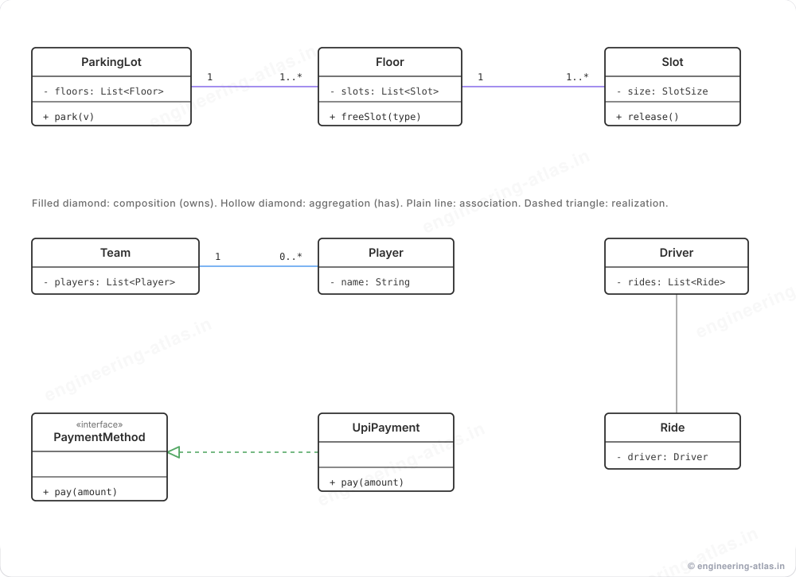</p>

| Topic | What it is, and why it matters | Free read |
|---|---|---|
| <a href="https://engineering-atlas.in/lld/class-relationships/association/?utm_source=github&utm_medium=lld-roadmap&utm_campaign=lld-association">Association</a><br><picture><source media="(prefers-color-scheme: dark)" srcset="diagrams/tags/beginner-dark.svg"></picture> | Two classes know about each other and work together, like a `Driver` and a `Ride`. Neither owns the other. |  |
| <a href="https://engineering-atlas.in/lld/class-relationships/aggregation/?utm_source=github&utm_medium=lld-roadmap&utm_campaign=lld-aggregation">Aggregation</a><br><picture><source media="(prefers-color-scheme: dark)" srcset="diagrams/tags/intermediate-dark.svg"></picture> | A "has-a" where the part can live on its own. A `Team` has `Players`, but a player still exists if the team is disbanded. |  |
| <a href="https://engineering-atlas.in/lld/class-relationships/composition/?utm_source=github&utm_medium=lld-roadmap&utm_campaign=lld-composition">Composition</a><br><picture><source media="(prefers-color-scheme: dark)" srcset="diagrams/tags/intermediate-dark.svg"></picture> | A strong "has-a": the part is created and destroyed with the whole. A `ParkingFloor` owns its `Slots`; delete the floor and the slots go with it. |  |
| <a href="https://engineering-atlas.in/lld/class-relationships/dependency/?utm_source=github&utm_medium=lld-roadmap&utm_campaign=lld-dependency">Dependency</a><br><picture><source media="(prefers-color-scheme: dark)" srcset="diagrams/tags/beginner-dark.svg"></picture> | One class uses another briefly, usually as a method parameter. The weakest link, and the one you want most of. |  |
| <a href="https://engineering-atlas.in/lld/class-relationships/realization/?utm_source=github&utm_medium=lld-roadmap&utm_campaign=lld-realization">Realization</a><br><picture><source media="(prefers-color-scheme: dark)" srcset="diagrams/tags/beginner-dark.svg"></picture> | A class implements an interface: `UpiPayment` realizes `PaymentMethod`. It is the dashed line with a hollow triangle in UML. |  |


### Can you answer these?

1. Should `VehicleType` be an enum or a class hierarchy? What would change your answer?
2. Give an example where inheritance is the wrong choice and say what you would use instead.
3. Is `Order` to `OrderItem` aggregation or composition? Why?
4. How does polymorphism help you add a new payment method without editing existing code?

**Continue learning on Engineering Atlas:** [LLD course: OOP fundamentals](https://engineering-atlas.in/lld/oop-fundamentals/?utm_source=github&utm_medium=lld-roadmap&utm_campaign=lld-oop-fundamentals)

<p align="right"><sub><a href="#contents">Back to contents ↑</a></sub></p>

---

## Part III: Design principles

<p align="center"><picture><source media="(prefers-color-scheme: dark)" srcset="diagrams/banners/part-3-dark.svg">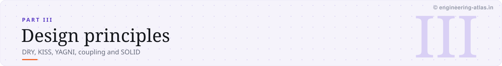</picture></p>

*Principles are how you judge a design before it is written.* Patterns come later; these are the rules that tell you which pattern you need and when you need none. Interviewers use them as their checklist.

### 06. Everyday Design Principles

<picture><source media="(prefers-color-scheme: dark)" srcset="diagrams/banners/ch-06-dark.svg"></picture>

<a href="https://engineering-atlas.in/lld/design-principles/?utm_source=github&utm_medium=lld-roadmap&utm_campaign=lld-design-principles"><picture><source media="(prefers-color-scheme: dark)" srcset="diagrams/banners/btn-chapter-dark.svg"></picture></a>

| | |
|---|---|
| **Why know this** | DRY, KISS, YAGNI and the Law of Demeter are the quiet reasons a design feels clean. Naming them while you code shows the interviewer you are choosing, not guessing. |
| **What interviewers test** | Do you keep the design plain, avoid speculative features and keep objects from reaching through each other? |
| **What you will cover** | Introduction to design principles · DRY principle · KISS principle · YAGNI principle · Law of Demeter · Separation of concerns |
| **Try this** | Find a method in your own code that chains three getters, and rewrite it so the caller asks one object for what it needs. |
| **Ready to move on when** | You can spot a Law of Demeter violation in one line of code, and explain when DRY goes too far. |


| Topic | What it is, and why it matters | Free read |
|---|---|---|
| <a href="https://engineering-atlas.in/lld/design-principles/introduction-to-design-principles/?utm_source=github&utm_medium=lld-roadmap&utm_campaign=lld-introduction-to-design-principles">Introduction to design principles</a><br><picture><source media="(prefers-color-scheme: dark)" srcset="diagrams/tags/beginner-dark.svg"></picture> | Principles are trade-off rules, not laws. Each one protects you from a specific kind of pain when the code changes. |  |
| <a href="https://engineering-atlas.in/lld/design-principles/dry-principle/?utm_source=github&utm_medium=lld-roadmap&utm_campaign=lld-dry-principle">DRY principle</a><br><picture><source media="(prefers-color-scheme: dark)" srcset="diagrams/tags/beginner-dark.svg"></picture> | Every piece of knowledge lives in one place. Duplicate code is fine when it only looks the same; merge it only when it changes for the same reason. |  |
| <a href="https://engineering-atlas.in/lld/design-principles/kiss-principle/?utm_source=github&utm_medium=lld-roadmap&utm_campaign=lld-kiss-principle">KISS principle</a><br><picture><source media="(prefers-color-scheme: dark)" srcset="diagrams/tags/beginner-dark.svg"></picture> | Pick the plainest design that meets the requirements. A clever generic framework in a 90-minute round is usually a mistake. |  |
| <a href="https://engineering-atlas.in/lld/design-principles/yagni-principle/?utm_source=github&utm_medium=lld-roadmap&utm_campaign=lld-yagni-principle">YAGNI principle</a><br><picture><source media="(prefers-color-scheme: dark)" srcset="diagrams/tags/beginner-dark.svg"></picture> | Don't build for requirements nobody asked for. Leave a seam (an interface) where change is likely, and stop there. | <a href="https://martinfowler.com/bliki/Yagni.html">Martin Fowler: Yagni</a> |
| <a href="https://engineering-atlas.in/lld/design-principles/law-of-demeter/?utm_source=github&utm_medium=lld-roadmap&utm_campaign=lld-law-of-demeter">Law of Demeter</a><br><picture><source media="(prefers-color-scheme: dark)" srcset="diagrams/tags/intermediate-dark.svg"></picture> | Talk to your direct friends only. `order.getCustomer().getAddress().getCity()` means `Order` knows too much about everything around it. | <a href="https://martinfowler.com/bliki/TellDontAsk.html">Martin Fowler: Tell, don't ask</a> |
| <a href="https://engineering-atlas.in/lld/design-principles/separation-of-concerns/?utm_source=github&utm_medium=lld-roadmap&utm_campaign=lld-separation-of-concerns">Separation of concerns</a><br><picture><source media="(prefers-color-scheme: dark)" srcset="diagrams/tags/intermediate-dark.svg"></picture> | Keep pricing, storage and notification in different classes. When one changes, the others don't have to. |  |


### 07. Coupling, Cohesion and Composition

<picture><source media="(prefers-color-scheme: dark)" srcset="diagrams/banners/ch-07-dark.svg"></picture>

<a href="https://engineering-atlas.in/lld/design-principles/?utm_source=github&utm_medium=lld-roadmap&utm_campaign=lld-design-principles"><picture><source media="(prefers-color-scheme: dark)" srcset="diagrams/banners/btn-chapter-dark.svg"></picture></a>

| | |
|---|---|
| **Why know this** | "Low coupling, high cohesion" is the one-line summary of good design, and "favour composition over inheritance" is the most useful rule for keeping it that way. |
| **What interviewers test** | Do you prefer small focused classes joined through interfaces over deep inheritance trees? |
| **What you will cover** | Coupling and cohesion · Composition over inheritance |
| **Try this** | Replace a `Bird` hierarchy (`FlyingBird`, `SwimmingBird`, `FlyingSwimmingBird`) with composition using `FlyBehaviour` and `SwimBehaviour`. |
| **Ready to move on when** | You can take a class hierarchy with four subclasses and turn it into composition with one interface, and say what you gained. |


| Topic | What it is, and why it matters | Free read |
|---|---|---|
| <a href="https://engineering-atlas.in/lld/design-principles/coupling-and-cohesion/?utm_source=github&utm_medium=lld-roadmap&utm_campaign=lld-coupling-and-cohesion">Coupling and cohesion</a><br><picture><source media="(prefers-color-scheme: dark)" srcset="diagrams/tags/intermediate-dark.svg"></picture> | Coupling is how much a class depends on others; cohesion is how closely its own parts belong together. Aim for classes that do one job and know little about the rest. |  |
| <a href="https://engineering-atlas.in/lld/design-principles/composition-over-inheritance/?utm_source=github&utm_medium=lld-roadmap&utm_campaign=lld-composition-over-inheritance">Composition over inheritance</a><br><picture><source media="(prefers-color-scheme: dark)" srcset="diagrams/tags/intermediate-dark.svg"></picture> | Build behaviour by holding objects, not by extending classes. A `Duck` with a `FlyBehaviour` field is easier to change than ten duck subclasses. |  |


### 08. SOLID Principles

<picture><source media="(prefers-color-scheme: dark)" srcset="diagrams/banners/ch-08-dark.svg"></picture>

<a href="https://engineering-atlas.in/lld/solid/?utm_source=github&utm_medium=lld-roadmap&utm_campaign=lld-solid"><picture><source media="(prefers-color-scheme: dark)" srcset="diagrams/banners/btn-chapter-dark.svg"></picture></a>

| | |
|---|---|
| **Why know this** | SOLID is the vocabulary of LLD reviews. Most follow-up questions ("now add a new vehicle type", "now support a second payment gateway") are SOLID questions in disguise. |
| **What interviewers test** | When a new requirement arrives, do you add a class instead of editing working code? |
| **What you will cover** | Single responsibility principle · Open/closed principle · Liskov substitution principle · Interface segregation principle · Dependency inversion principle |
| **Try this** | Take an `if` chain that computes discounts by customer type and refactor it to follow open/closed. Then add a new type without editing old code. |
| **Ready to move on when** | You can name all five, show a violation and its fix in code for each, and say which one a new requirement is testing. |


<p align="center">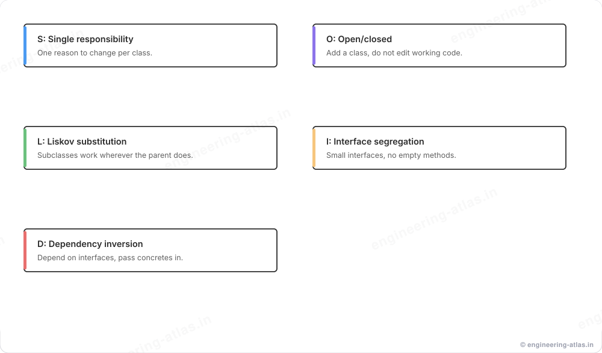</p>

| Topic | What it is, and why it matters | Free read |
|---|---|---|
| <a href="https://engineering-atlas.in/lld/solid/single-responsibility-principle/?utm_source=github&utm_medium=lld-roadmap&utm_campaign=lld-single-responsibility-principle">Single responsibility principle</a><br><picture><source media="(prefers-color-scheme: dark)" srcset="diagrams/tags/beginner-dark.svg"></picture> | A class should have one reason to change. If pricing rules and receipt printing live in one class, a new tax rule can break printing. | <a href="https://blog.cleancoder.com/uncle-bob/2014/05/08/SingleReponsibilityPrinciple.html">Robert C. Martin: The single responsibility principle</a> |
| <a href="https://engineering-atlas.in/lld/solid/open-closed-principle/?utm_source=github&utm_medium=lld-roadmap&utm_campaign=lld-open-closed-principle">Open/closed principle</a><br><picture><source media="(prefers-color-scheme: dark)" srcset="diagrams/tags/intermediate-dark.svg"></picture> | Open for extension, closed for modification. Add a new discount by adding a class, not by editing an `if` chain that already works. |  |
| <a href="https://engineering-atlas.in/lld/solid/liskov-substitution-principle/?utm_source=github&utm_medium=lld-roadmap&utm_campaign=lld-liskov-substitution-principle">Liskov substitution principle</a><br><picture><source media="(prefers-color-scheme: dark)" srcset="diagrams/tags/intermediate-dark.svg"></picture> | A subclass must work anywhere its parent does. If `Penguin extends Bird` throws on `fly()`, the hierarchy is wrong, not the caller. |  |
| <a href="https://engineering-atlas.in/lld/solid/interface-segregation-principle/?utm_source=github&utm_medium=lld-roadmap&utm_campaign=lld-interface-segregation-principle">Interface segregation principle</a><br><picture><source media="(prefers-color-scheme: dark)" srcset="diagrams/tags/intermediate-dark.svg"></picture> | Many small interfaces beat one large one. A `Printer` shouldn't have to implement `fax()` because a multifunction device needed it. |  |
| <a href="https://engineering-atlas.in/lld/solid/dependency-inversion-principle/?utm_source=github&utm_medium=lld-roadmap&utm_campaign=lld-dependency-inversion-principle">Dependency inversion principle</a><br><picture><source media="(prefers-color-scheme: dark)" srcset="diagrams/tags/intermediate-dark.svg"></picture> | High-level code depends on interfaces, and the concrete classes are passed in. That is what makes a design testable and swappable. | <a href="https://martinfowler.com/articles/injection.html">Martin Fowler: Inversion of control containers and the dependency injection pattern</a> |

#### Deep dive: open/closed in one refactor

The most common follow-up in an LLD round is "now add a new type". If your code looks like this, every new type means editing a method that already works:

```java
double fee(Vehicle v, long hours) {
    switch (v.type()) {
        case BIKE:  return hours * 10;
        case CAR:   return hours * 20;
        case TRUCK: return hours * 50;
        default: throw new IllegalArgumentException();
    }
}
```

Move each rule behind an interface and pick the rule from a map. A new vehicle type is now a new class and one line of wiring; `fee` never changes again.

```java
interface FeeRule { double fee(long hours); }

final class FeeCalculator {
    private final Map<VehicleType, FeeRule> rules;
    FeeCalculator(Map<VehicleType, FeeRule> rules) { this.rules = Map.copyOf(rules); }
    double fee(Vehicle v, long hours) { return rules.get(v.type()).fee(hours); }
}
```

> [!TIP]
> **In the interview.** Say it before you are asked: "Fees will grow by type, so I'll keep them behind a `FeeRule` interface. A new type won't touch `FeeCalculator`."


### Can you answer these?

1. Which SOLID principle does "add a new vehicle type without editing `ParkingLot`" test?
2. Why does `Square extends Rectangle` break Liskov substitution?
3. When is duplicated code better than a shared helper?
4. What is the difference between dependency inversion and dependency injection?

**Continue learning on Engineering Atlas:** [LLD course: SOLID principles](https://engineering-atlas.in/lld/solid/?utm_source=github&utm_medium=lld-roadmap&utm_campaign=lld-solid)

<p align="right"><sub><a href="#contents">Back to contents ↑</a></sub></p>

## Part IV: UML for interviews

<p align="center"><picture><source media="(prefers-color-scheme: dark)" srcset="diagrams/banners/part-4-dark.svg">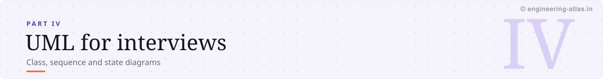</picture></p>

*UML is how you show a design before you write it.* You don't need every diagram type. You need a clean class diagram, a sequence diagram for the tricky flow, and a state diagram when an object has a lifecycle.

### 09. Class Diagrams

<picture><source media="(prefers-color-scheme: dark)" srcset="diagrams/banners/ch-09-dark.svg"></picture>

<a href="https://engineering-atlas.in/lld/uml/?utm_source=github&utm_medium=lld-roadmap&utm_campaign=lld-uml"><picture><source media="(prefers-color-scheme: dark)" srcset="diagrams/banners/btn-chapter-dark.svg"></picture></a>

| | |
|---|---|
| **Why know this** | The class diagram is the first thing most interviewers ask for and the main thing they grade before code. A clear one makes the code almost write itself. |
| **What interviewers test** | Can you draw a clear class diagram quickly, with the right lines and only the members that matter? |
| **What you will cover** | Class diagram |
| **Try this** | Draw the class diagram for a movie ticket booking system in 10 minutes using Mermaid, and render it in a GitHub README. |
| **Ready to move on when** | You can draw a class diagram for a library system in 10 minutes with the right relationship lines and multiplicities. |


| Topic | What it is, and why it matters | Free read |
|---|---|---|
| <a href="https://engineering-atlas.in/lld/uml/class-diagram/?utm_source=github&utm_medium=lld-roadmap&utm_campaign=lld-class-diagram">Class diagram</a><br><picture><source media="(prefers-color-scheme: dark)" srcset="diagrams/tags/beginner-dark.svg"></picture> | Boxes for classes with fields and methods, lines for relationships, numbers for multiplicity. Draw only what the reader needs: key fields, public methods. | <a href="https://mermaid.js.org/syntax/classDiagram.html">Mermaid: Class diagram syntax</a> |


### 10. Behaviour Diagrams

<picture><source media="(prefers-color-scheme: dark)" srcset="diagrams/banners/ch-10-dark.svg"></picture>

<a href="https://engineering-atlas.in/lld/uml/?utm_source=github&utm_medium=lld-roadmap&utm_campaign=lld-uml"><picture><source media="(prefers-color-scheme: dark)" srcset="diagrams/banners/btn-chapter-dark.svg"></picture></a>

| | |
|---|---|
| **Why know this** | A class diagram shows structure; it can't show order or lifecycle. A sequence or state diagram is often the fastest way to prove your design handles a tricky flow, like a payment that times out. |
| **What interviewers test** | Can you use a sequence or state diagram to prove a tricky flow works? |
| **What you will cover** | Sequence diagram · State machine diagram · Use case diagram · Activity diagram |
| **Try this** | Draw the state machine for an e-commerce order (placed, paid, shipped, delivered, cancelled) and list the illegal transitions. |
| **Ready to move on when** | You can draw the sequence for "user books a seat" and the state machine for an order, and use them to find a missing method. |


| Topic | What it is, and why it matters | Free read |
|---|---|---|
| <a href="https://engineering-atlas.in/lld/uml/sequence-diagram/?utm_source=github&utm_medium=lld-roadmap&utm_campaign=lld-sequence-diagram">Sequence diagram</a><br><picture><source media="(prefers-color-scheme: dark)" srcset="diagrams/tags/intermediate-dark.svg"></picture> | Objects across the top, time going down, messages as arrows. Best for showing who calls whom in one use case. | <a href="https://mermaid.js.org/syntax/sequenceDiagram.html">Mermaid: Sequence diagram syntax</a> |
| <a href="https://engineering-atlas.in/lld/uml/state-machine-diagram/?utm_source=github&utm_medium=lld-roadmap&utm_campaign=lld-state-machine-diagram">State machine diagram</a><br><picture><source media="(prefers-color-scheme: dark)" srcset="diagrams/tags/intermediate-dark.svg"></picture> | States as boxes, events as arrows. Vending machines, elevators, orders and tickets all have lifecycles, and this diagram catches illegal moves. |  |
| <a href="https://engineering-atlas.in/lld/uml/use-case-diagram/?utm_source=github&utm_medium=lld-roadmap&utm_campaign=lld-use-case-diagram">Use case diagram</a><br><picture><source media="(prefers-color-scheme: dark)" srcset="diagrams/tags/beginner-dark.svg"></picture> | Actors and what they can do. A quick way to agree on scope in the first five minutes. |  |
| <a href="https://engineering-atlas.in/lld/uml/activity-diagram/?utm_source=github&utm_medium=lld-roadmap&utm_campaign=lld-activity-diagram">Activity diagram</a><br><picture><source media="(prefers-color-scheme: dark)" srcset="diagrams/tags/beginner-dark.svg"></picture> | A flowchart with decisions and parallel steps. Handy for a checkout or approval flow with branches. |  |


### Can you answer these?

1. Which UML line means "implements an interface"? Which means "owns and destroys"?
2. When would you draw a sequence diagram instead of a class diagram?
3. Draw the states of a vending machine. Which event is illegal in the "dispensing" state?

**Continue learning on Engineering Atlas:** [LLD course: UML diagrams](https://engineering-atlas.in/lld/uml/?utm_source=github&utm_medium=lld-roadmap&utm_campaign=lld-uml)

<p align="right"><sub><a href="#contents">Back to contents ↑</a></sub></p>

---

## Part V: Design patterns

<p align="center"><picture><source media="(prefers-color-scheme: dark)" srcset="diagrams/banners/part-5-dark.svg">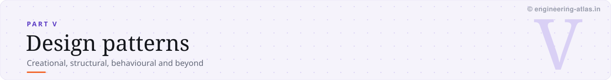</picture></p>

*Patterns are named solutions to problems you will meet again and again.* Learn each one as "the problem it solves" first and "the class diagram" second. In the round, say the problem out loud, then name the pattern.

<p align="center">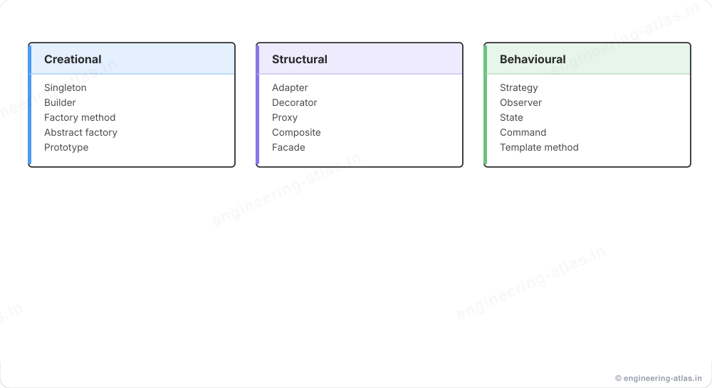</p>

### 11. Creational Patterns

<picture><source media="(prefers-color-scheme: dark)" srcset="diagrams/banners/ch-11-dark.svg"></picture>

<a href="https://engineering-atlas.in/lld/creational-patterns/?utm_source=github&utm_medium=lld-roadmap&utm_campaign=lld-creational-patterns"><picture><source media="(prefers-color-scheme: dark)" srcset="diagrams/banners/btn-chapter-dark.svg"></picture></a>

| | |
|---|---|
| **Why know this** | Object creation spreads through a codebase quickly. Creational patterns put it in one place, so adding a new type or a new configuration touches one class instead of twenty. |
| **What interviewers test** | Do you centralise object creation, and do you know the cost of a singleton? |
| **What you will cover** | Introduction to design patterns · Singleton · Builder · Factory method · Abstract factory · Prototype |
| **Try this** | Write a `NotificationFactory` that returns email, SMS or push senders by type, then add a WhatsApp sender with one new class. |
| **Ready to move on when** | You can explain the difference between factory method and abstract factory, and write a thread-safe lazy singleton. |


| Topic | What it is, and why it matters | Free read |
|---|---|---|
| <a href="https://engineering-atlas.in/lld/creational-patterns/introduction-to-design-patterns/?utm_source=github&utm_medium=lld-roadmap&utm_campaign=lld-introduction-to-design-patterns">Introduction to design patterns</a><br><picture><source media="(prefers-color-scheme: dark)" srcset="diagrams/tags/beginner-dark.svg"></picture> | The 23 classic patterns fall into three families: creating objects, composing them, and dividing behaviour between them. |  |
| <a href="https://engineering-atlas.in/lld/creational-patterns/singleton/?utm_source=github&utm_medium=lld-roadmap&utm_campaign=lld-singleton">Singleton</a><br><picture><source media="(prefers-color-scheme: dark)" srcset="diagrams/tags/beginner-dark.svg"></picture> | Exactly one instance, reachable from anywhere. Fine for a logger or config; overused for everything else, because it hides dependencies and makes tests harder. | <a href="https://refactoring.guru/design-patterns/singleton">Refactoring Guru: Singleton</a> |
| <a href="https://engineering-atlas.in/lld/creational-patterns/builder/?utm_source=github&utm_medium=lld-roadmap&utm_campaign=lld-builder">Builder</a><br><picture><source media="(prefers-color-scheme: dark)" srcset="diagrams/tags/beginner-dark.svg"></picture> | Build a complex object step by step with readable calls instead of a constructor with nine arguments. |  |
| <a href="https://engineering-atlas.in/lld/creational-patterns/factory-method/?utm_source=github&utm_medium=lld-roadmap&utm_campaign=lld-factory-method">Factory method</a><br><picture><source media="(prefers-color-scheme: dark)" srcset="diagrams/tags/beginner-dark.svg"></picture> | One method decides which concrete class to create. Callers ask for "a vehicle for this type" and never use `new` on a subclass. | <a href="https://refactoring.guru/design-patterns/factory-method">Refactoring Guru: Factory method</a> |
| <a href="https://engineering-atlas.in/lld/creational-patterns/abstract-factory/?utm_source=github&utm_medium=lld-roadmap&utm_campaign=lld-abstract-factory">Abstract factory</a><br><picture><source media="(prefers-color-scheme: dark)" srcset="diagrams/tags/intermediate-dark.svg"></picture> | Creates whole families of objects that must match, like light-theme buttons with light-theme checkboxes. |  |
| <a href="https://engineering-atlas.in/lld/creational-patterns/prototype/?utm_source=github&utm_medium=lld-roadmap&utm_campaign=lld-prototype">Prototype</a><br><picture><source media="(prefers-color-scheme: dark)" srcset="diagrams/tags/intermediate-dark.svg"></picture> | Copy an existing configured object instead of building a new one from scratch. |  |

#### Deep dive: a thread-safe singleton

If you must write a singleton, the safest and shortest form in Java is an enum. The JVM creates it once, lazily, and serialisation can't make a second copy.

```java
public enum AppConfig {
    INSTANCE;
    private final Properties props = load();
    public String get(String key) { return props.getProperty(key); }
}
```

If the interviewer wants a class, use the holder idiom. The inner class loads on first use, and class loading is thread-safe, so no lock is needed.

```java
public final class IdGenerator {
    private IdGenerator() {}
    private static final class Holder { static final IdGenerator INSTANCE = new IdGenerator(); }
    public static IdGenerator getInstance() { return Holder.INSTANCE; }
}
```

> [!NOTE]
> **The better answer.** Most "singletons" in LLD answers should be one object created in `main` and passed in through constructors. You still get one instance, and tests can pass a fake.


### 12. Structural Patterns

<picture><source media="(prefers-color-scheme: dark)" srcset="diagrams/banners/ch-12-dark.svg"></picture>

<a href="https://engineering-atlas.in/lld/structural-patterns/?utm_source=github&utm_medium=lld-roadmap&utm_campaign=lld-structural-patterns"><picture><source media="(prefers-color-scheme: dark)" srcset="diagrams/banners/btn-chapter-dark.svg"></picture></a>

| | |
|---|---|
| **Why know this** | Structural patterns let you add behaviour or fit mismatched parts together without rewriting classes that already work. They are the patterns most often hiding inside real libraries. |
| **What interviewers test** | Can you add behaviour or fit an external API without changing existing classes? |
| **What you will cover** | Introduction to structural patterns · Adapter · Decorator · Proxy · Composite · Facade · Bridge · Flyweight · Structural patterns compared |
| **Try this** | Write an `Adapter` that wraps a fake third-party `StripeClient` behind your own `PaymentGateway` interface. |
| **Ready to move on when** | You can tell decorator, proxy and adapter apart from their intent, since their class diagrams look almost the same. |


<p align="center">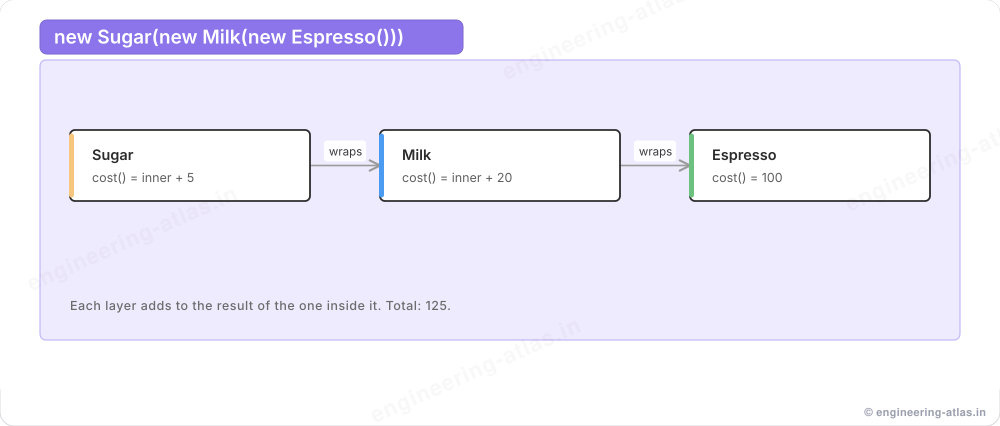</p>

| Topic | What it is, and why it matters | Free read |
|---|---|---|
| <a href="https://engineering-atlas.in/lld/structural-patterns/introduction-to-structural-patterns/?utm_source=github&utm_medium=lld-roadmap&utm_campaign=lld-introduction-to-structural-patterns">Introduction to structural patterns</a><br><picture><source media="(prefers-color-scheme: dark)" srcset="diagrams/tags/beginner-dark.svg"></picture> | How to combine classes and objects into larger structures while keeping each piece small. |  |
| <a href="https://engineering-atlas.in/lld/structural-patterns/adapter/?utm_source=github&utm_medium=lld-roadmap&utm_campaign=lld-adapter">Adapter</a><br><picture><source media="(prefers-color-scheme: dark)" srcset="diagrams/tags/beginner-dark.svg"></picture> | Wrap a class so it fits an interface your code expects. The classic use: plugging a third-party payment SDK into your own `PaymentGateway` interface. |  |
| <a href="https://engineering-atlas.in/lld/structural-patterns/decorator/?utm_source=github&utm_medium=lld-roadmap&utm_campaign=lld-decorator">Decorator</a><br><picture><source media="(prefers-color-scheme: dark)" srcset="diagrams/tags/intermediate-dark.svg"></picture> | Wrap an object to add behaviour at runtime, layer by layer. Java's I/O streams are decorators all the way down. | <a href="https://refactoring.guru/design-patterns/decorator">Refactoring Guru: Decorator</a> |
| <a href="https://engineering-atlas.in/lld/structural-patterns/proxy/?utm_source=github&utm_medium=lld-roadmap&utm_campaign=lld-proxy">Proxy</a><br><picture><source media="(prefers-color-scheme: dark)" srcset="diagrams/tags/intermediate-dark.svg"></picture> | A stand-in that controls access to the real object: lazy loading, caching, access checks or rate limiting. |  |
| <a href="https://engineering-atlas.in/lld/structural-patterns/composite/?utm_source=github&utm_medium=lld-roadmap&utm_campaign=lld-composite">Composite</a><br><picture><source media="(prefers-color-scheme: dark)" srcset="diagrams/tags/intermediate-dark.svg"></picture> | Treat a single item and a group the same way. Files and folders, menu items and sub-menus. |  |
| <a href="https://engineering-atlas.in/lld/structural-patterns/facade/?utm_source=github&utm_medium=lld-roadmap&utm_campaign=lld-facade">Facade</a><br><picture><source media="(prefers-color-scheme: dark)" srcset="diagrams/tags/beginner-dark.svg"></picture> | One simple entry point to a complicated subsystem, like `checkout()` hiding inventory, pricing and payment. |  |
| <a href="https://engineering-atlas.in/lld/structural-patterns/bridge/?utm_source=github&utm_medium=lld-roadmap&utm_campaign=lld-bridge">Bridge</a><br><picture><source media="(prefers-color-scheme: dark)" srcset="diagrams/tags/advanced-dark.svg"></picture> | Split an abstraction from its implementation so both can vary, like shapes and the renderers that draw them. |  |
| <a href="https://engineering-atlas.in/lld/structural-patterns/flyweight/?utm_source=github&utm_medium=lld-roadmap&utm_campaign=lld-flyweight">Flyweight</a><br><picture><source media="(prefers-color-scheme: dark)" srcset="diagrams/tags/advanced-dark.svg"></picture> | Share the common part of many small objects to save memory, like one glyph object per character in a text editor. |  |
| <a href="https://engineering-atlas.in/lld/structural-patterns/structural-patterns-compared/?utm_source=github&utm_medium=lld-roadmap&utm_campaign=lld-structural-patterns-compared">Structural patterns compared</a><br><picture><source media="(prefers-color-scheme: dark)" srcset="diagrams/tags/intermediate-dark.svg"></picture> | Side by side: what each one wraps, why, and the question that tells them apart. |  |


### 13. Behavioural Patterns: the Everyday Six

<picture><source media="(prefers-color-scheme: dark)" srcset="diagrams/banners/ch-13-dark.svg">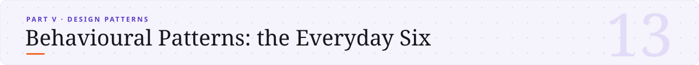</picture>

<a href="https://engineering-atlas.in/lld/behavioral-patterns/?utm_source=github&utm_medium=lld-roadmap&utm_campaign=lld-behavioral-patterns"><picture><source media="(prefers-color-scheme: dark)" srcset="diagrams/banners/btn-chapter-dark.svg"></picture></a>

| | |
|---|---|
| **Why know this** | Strategy, Observer and State alone cover a large share of machine coding problems: pricing rules, notifications and lifecycles. Learn these six until you can write them without notes. |
| **What interviewers test** | Do you replace type switches and status switches with Strategy and State? |
| **What you will cover** | Strategy · Observer · State · Command · Template method · Chain of responsibility |
| **Try this** | Implement a traffic light with the State pattern, then add a "flashing amber" night mode as one new class. |
| **Ready to move on when** | You can replace a `switch` on status with the State pattern, and explain when Strategy is the better choice. |


<p align="center">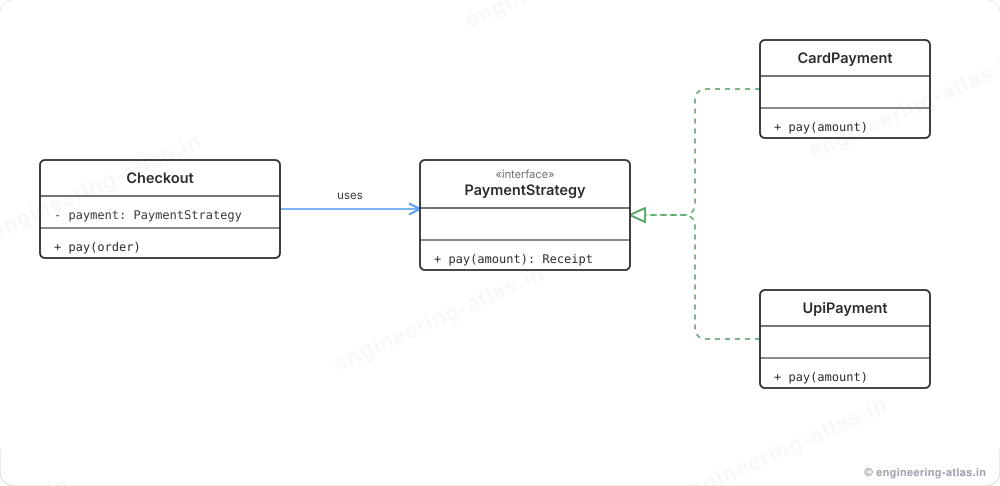</p>

| Topic | What it is, and why it matters | Free read |
|---|---|---|
| <a href="https://engineering-atlas.in/lld/behavioral-patterns/strategy/?utm_source=github&utm_medium=lld-roadmap&utm_campaign=lld-strategy">Strategy</a><br><picture><source media="(prefers-color-scheme: dark)" srcset="diagrams/tags/beginner-dark.svg"></picture> | Put each algorithm behind one interface and pick one at runtime: pricing rules, slot allocation, payment methods. | <a href="https://refactoring.guru/design-patterns/strategy">Refactoring Guru: Strategy</a> |
| <a href="https://engineering-atlas.in/lld/behavioral-patterns/observer/?utm_source=github&utm_medium=lld-roadmap&utm_campaign=lld-observer">Observer</a><br><picture><source media="(prefers-color-scheme: dark)" srcset="diagrams/tags/beginner-dark.svg"></picture> | Subscribers register with a subject and get notified when it changes. The shape behind notifications, event listeners and stock tickers. | <a href="https://refactoring.guru/design-patterns/observer">Refactoring Guru: Observer</a> |
| <a href="https://engineering-atlas.in/lld/behavioral-patterns/state/?utm_source=github&utm_medium=lld-roadmap&utm_campaign=lld-state">State</a><br><picture><source media="(prefers-color-scheme: dark)" srcset="diagrams/tags/intermediate-dark.svg"></picture> | Each state is a class that handles events its own way, so the object changes behaviour as its state changes. Vending machines and elevators live here. | <a href="https://refactoring.guru/design-patterns/state">Refactoring Guru: State</a> |
| <a href="https://engineering-atlas.in/lld/behavioral-patterns/command/?utm_source=github&utm_medium=lld-roadmap&utm_campaign=lld-command">Command</a><br><picture><source media="(prefers-color-scheme: dark)" srcset="diagrams/tags/intermediate-dark.svg"></picture> | Turn a request into an object you can queue, log or undo. Text editors, job queues and remote controls. |  |
| <a href="https://engineering-atlas.in/lld/behavioral-patterns/template-method/?utm_source=github&utm_medium=lld-roadmap&utm_campaign=lld-template-method">Template method</a><br><picture><source media="(prefers-color-scheme: dark)" srcset="diagrams/tags/intermediate-dark.svg"></picture> | A base class fixes the steps of an algorithm; subclasses fill in some steps. Good when the order must never change. |  |
| <a href="https://engineering-atlas.in/lld/behavioral-patterns/chain-of-responsibility/?utm_source=github&utm_medium=lld-roadmap&utm_campaign=lld-chain-of-responsibility">Chain of responsibility</a><br><picture><source media="(prefers-color-scheme: dark)" srcset="diagrams/tags/intermediate-dark.svg"></picture> | Pass a request along a chain of handlers until one deals with it. Logging levels, approval flows, ATM cash dispensing. |  |

#### Deep dive: Strategy or State?

Both put behaviour behind an interface, so their class diagrams look the same. The difference is **who picks the implementation and when it changes**.

| | Strategy | State |
|---|---|---|
| Who chooses | The caller or configuration | The object itself, as events arrive |
| How often it changes | Rarely, often once at start | On every transition |
| Do the classes know each other? | No | Yes: each state knows the next ones |
| Example | `PricingStrategy` for a parking lot | `IdleState`, `HasMoneyState` in a vending machine |

A quick test: if you can name the implementations as **policies** ("nearest slot first", "cheapest route"), it is Strategy. If you name them as **situations** ("waiting for coins", "door open"), it is State.


### 14. Behavioural Patterns: the Specialists

<picture><source media="(prefers-color-scheme: dark)" srcset="diagrams/banners/ch-14-dark.svg"></picture>

<a href="https://engineering-atlas.in/lld/behavioral-patterns/?utm_source=github&utm_medium=lld-roadmap&utm_campaign=lld-behavioral-patterns"><picture><source media="(prefers-color-scheme: dark)" srcset="diagrams/banners/btn-chapter-dark.svg"></picture></a>

| | |
|---|---|
| **Why know this** | These come up less often, but when a problem needs one, nothing else fits as well. Knowing them by name lets you answer "how would you add undo?" or "how would you walk this tree?" in one sentence. |
| **What interviewers test** | Can you name the right pattern for undo, traversal and adding operations to a fixed hierarchy? |
| **What you will cover** | Iterator · Mediator · Memento · Visitor · Interpreter · Behavioural patterns compared |
| **Try this** | Add undo to a tiny text editor with the Command pattern, supporting `type`, `delete` and three levels of undo. |
| **Ready to move on when** | You can name the pattern for undo, for walking a collection without exposing it, and for adding operations to a fixed class hierarchy. |


| Topic | What it is, and why it matters | Free read |
|---|---|---|
| <a href="https://engineering-atlas.in/lld/behavioral-patterns/iterator/?utm_source=github&utm_medium=lld-roadmap&utm_campaign=lld-iterator">Iterator</a><br><picture><source media="(prefers-color-scheme: dark)" srcset="diagrams/tags/beginner-dark.svg"></picture> | Walk a collection without knowing how it is stored. Java's `Iterable` and the for-each loop are built on it. |  |
| <a href="https://engineering-atlas.in/lld/behavioral-patterns/mediator/?utm_source=github&utm_medium=lld-roadmap&utm_campaign=lld-mediator">Mediator</a><br><picture><source media="(prefers-color-scheme: dark)" srcset="diagrams/tags/intermediate-dark.svg"></picture> | Objects talk through one coordinator instead of to each other. A chat room or an air traffic controller. |  |
| <a href="https://engineering-atlas.in/lld/behavioral-patterns/memento/?utm_source=github&utm_medium=lld-roadmap&utm_campaign=lld-memento">Memento</a><br><picture><source media="(prefers-color-scheme: dark)" srcset="diagrams/tags/intermediate-dark.svg"></picture> | Save and restore an object's state without exposing its internals. The cleanest way to build undo. |  |
| <a href="https://engineering-atlas.in/lld/behavioral-patterns/visitor/?utm_source=github&utm_medium=lld-roadmap&utm_campaign=lld-visitor">Visitor</a><br><picture><source media="(prefers-color-scheme: dark)" srcset="diagrams/tags/advanced-dark.svg"></picture> | Add new operations to a stable class hierarchy without editing it, like computing tax and shipping over the same order items. |  |
| <a href="https://engineering-atlas.in/lld/behavioral-patterns/interpreter/?utm_source=github&utm_medium=lld-roadmap&utm_campaign=lld-interpreter">Interpreter</a><br><picture><source media="(prefers-color-scheme: dark)" srcset="diagrams/tags/advanced-dark.svg"></picture> | Represent a small language as classes and evaluate it. Rare in interviews, useful for rule engines and filters. |  |
| <a href="https://engineering-atlas.in/lld/behavioral-patterns/behavioral-patterns-compared/?utm_source=github&utm_medium=lld-roadmap&utm_campaign=lld-behavioral-patterns-compared">Behavioural patterns compared</a><br><picture><source media="(prefers-color-scheme: dark)" srcset="diagrams/tags/intermediate-dark.svg"></picture> | Strategy vs State, Command vs Strategy, Observer vs Mediator: the pairs people mix up, side by side. |  |


### 15. Patterns Beyond the Classic 23

<picture><source media="(prefers-color-scheme: dark)" srcset="diagrams/banners/ch-15-dark.svg"></picture>

| | |
|---|---|
| **Why know this** | Real codebases use a handful of patterns that never made the original book. Interviewers expect you to know the repository and dependency injection at least, because almost every service uses them. |
| **What interviewers test** | Do you hide storage behind a repository and pass dependencies in through constructors? |
| **What you will cover** | Repository pattern · Dependency injection pattern · Null object pattern · MVC pattern · Specification pattern · Game loop pattern |
| **Try this** | Write a `TicketService` that depends on a `TicketRepository` interface, and test it with an in-memory implementation. |
| **Ready to move on when** | You can explain why a repository makes a design testable, and how dependency injection removes `new` from your business logic. |


| Topic | What it is, and why it matters | Free read |
|---|---|---|
| Repository pattern<br><picture><source media="(prefers-color-scheme: dark)" srcset="diagrams/tags/beginner-dark.svg"></picture> | Hide storage behind an interface like `TicketRepository`. Business code doesn't know or care whether it is a map, a database or a file. | <a href="https://martinfowler.com/eaaCatalog/repository.html">Martin Fowler: Repository</a> |
| Dependency injection pattern<br><picture><source media="(prefers-color-scheme: dark)" srcset="diagrams/tags/beginner-dark.svg"></picture> | Pass collaborators in through the constructor instead of creating them inside. This is the practical form of dependency inversion. |  |
| Null object pattern<br><picture><source media="(prefers-color-scheme: dark)" srcset="diagrams/tags/beginner-dark.svg"></picture> | Return an object that does nothing instead of `null`, so callers never need a null check. |  |
| MVC pattern<br><picture><source media="(prefers-color-scheme: dark)" srcset="diagrams/tags/intermediate-dark.svg"></picture> | Split data, display and input handling into model, view and controller. |  |
| Specification pattern<br><picture><source media="(prefers-color-scheme: dark)" srcset="diagrams/tags/intermediate-dark.svg"></picture> | Turn business rules into small combinable objects: `isAvailable().and(fitsVehicle(type))`. |  |
| Game loop pattern<br><picture><source media="(prefers-color-scheme: dark)" srcset="diagrams/tags/advanced-dark.svg"></picture> | Process input, update state, render, repeat. The backbone of every game-style LLD problem. |  |


### Can you answer these?

1. A new payment method is added every quarter. Which pattern, and why?
2. What is the difference between Strategy and State? Give a problem where each fits.
3. Decorator, Proxy and Adapter all wrap an object. How do you tell them apart?
4. Why do singletons make unit tests harder, and what do you use instead?

**Continue learning on Engineering Atlas:** [LLD course: Behavioral patterns](https://engineering-atlas.in/lld/behavioral-patterns/?utm_source=github&utm_medium=lld-roadmap&utm_campaign=lld-behavioral-patterns)

<p align="right"><sub><a href="#contents">Back to contents ↑</a></sub></p>

---

## Part VI: Concurrency for LLD

<p align="center"><picture><source media="(prefers-color-scheme: dark)" srcset="diagrams/banners/part-6-dark.svg">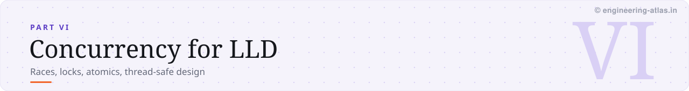</picture></p>

*The follow-up that separates good answers from great ones: "What if two users do this at the same time?"* Parking lots, booking systems, rate limiters and caches all share state between threads. This part gives you the Java tools and the design habits to keep that state correct.

### 16. Threads and Race Conditions

<picture><source media="(prefers-color-scheme: dark)" srcset="diagrams/banners/ch-16-dark.svg"></picture>

<a href="https://engineering-atlas.in/java/multithreading/?utm_source=github&utm_medium=lld-roadmap&utm_campaign=java-multithreading"><picture><source media="(prefers-color-scheme: dark)" srcset="diagrams/banners/btn-chapter-dark.svg"></picture></a>

| | |
|---|---|
| **Why know this** | You can't fix a race condition you can't see. Most concurrency bugs in LLD answers are a plain read-check-write on a shared field, and spotting one is the first skill. |
| **What interviewers test** | Can you spot a read-check-write race in your own code? |
| **What you will cover** | Processes vs threads · Creating threads: Thread, Runnable and Callable · Race conditions · Thread lifecycle and states |
| **Try this** | Increment a shared counter from 4 threads 100,000 times each without synchronisation. Print the result and explain why it is wrong. |
| **Ready to move on when** | You can find the race in "check the seat is free, then book it" and explain why it fails only under load. |


<p align="center">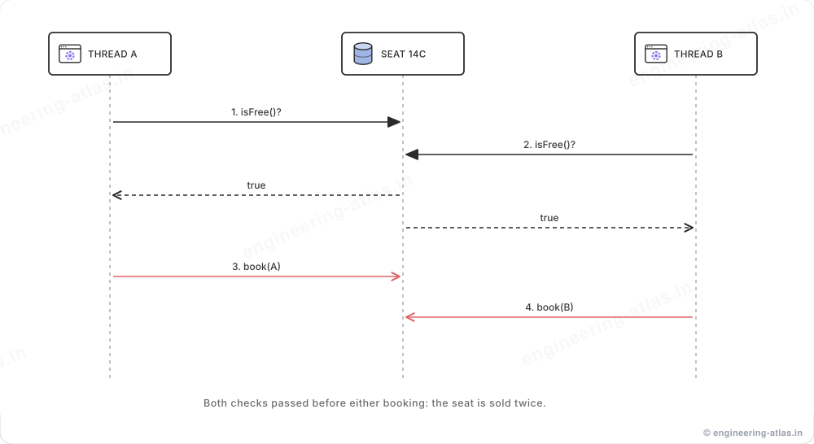</p>

| Topic | What it is, and why it matters | Free read |
|---|---|---|
| <a href="https://engineering-atlas.in/java/multithreading/processes-vs-threads/?utm_source=github&utm_medium=lld-roadmap&utm_campaign=java-processes-vs-threads">Processes vs threads</a><br><picture><source media="(prefers-color-scheme: dark)" srcset="diagrams/tags/beginner-dark.svg"></picture> | A process has its own memory; threads inside it share memory. Sharing is what makes threads fast and what makes them dangerous. |  |
| <a href="https://engineering-atlas.in/java/multithreading/creating-threads-thread-runnable-and-callable/?utm_source=github&utm_medium=lld-roadmap&utm_campaign=java-creating-threads-thread-runnable-and-callable">Creating threads: Thread, Runnable and Callable</a><br><picture><source media="(prefers-color-scheme: dark)" srcset="diagrams/tags/beginner-dark.svg"></picture> | `Runnable` for work with no result, `Callable` when you need one back. In real code you hand them to an executor rather than starting threads yourself. |  |
| <a href="https://engineering-atlas.in/java/multithreading/race-conditions/?utm_source=github&utm_medium=lld-roadmap&utm_campaign=java-race-conditions">Race conditions</a><br><picture><source media="(prefers-color-scheme: dark)" srcset="diagrams/tags/beginner-dark.svg"></picture> | Two threads read, decide and write the same data, and the result depends on timing. `count++` is three steps, not one. | <a href="https://docs.oracle.com/javase/tutorial/essential/concurrency/index.html">Oracle Java tutorial: Concurrency</a> |
| <a href="https://engineering-atlas.in/java/multithreading/thread-lifecycle-and-states/?utm_source=github&utm_medium=lld-roadmap&utm_campaign=java-thread-lifecycle-and-states">Thread lifecycle and states</a><br><picture><source media="(prefers-color-scheme: dark)" srcset="diagrams/tags/beginner-dark.svg"></picture> | New, runnable, blocked, waiting, timed waiting, terminated. Thread dumps show these states, so knowing them helps you debug a stuck system. |  |

#### Deep dive: check-then-act

This is the bug behind most double bookings. Each line is correct on its own; the problem is the gap between them.

```java
if (seat.isFree()) {        // thread A and thread B both see true
    seat.book(userId);      // both book: the seat is sold twice
}
```

Three fixes, from simplest to most scalable:

1. **Lock the check and the act together.** `synchronized (seat) {{ if (seat.isFree()) seat.book(userId); }}` makes the pair one step.
2. **Make the update atomic.** Keep the holder in an `AtomicReference` and book with `holder.compareAndSet(null, userId)`. Exactly one thread wins; the other gets `false`.
3. **Let the store decide.** In a real system, a database unique constraint or a conditional update does the same job across many servers.

> [!TIP]
> **In the interview.** Whenever you write `if (...) then change`, ask yourself out loud: "What if two threads reach this line together?"


### 17. Locks and Visibility

<picture><source media="(prefers-color-scheme: dark)" srcset="diagrams/banners/ch-17-dark.svg">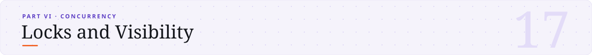</picture>

<a href="https://engineering-atlas.in/java/multithreading/?utm_source=github&utm_medium=lld-roadmap&utm_campaign=java-multithreading"><picture><source media="(prefers-color-scheme: dark)" srcset="diagrams/banners/btn-chapter-dark.svg"></picture></a>

| | |
|---|---|
| **Why know this** | A lock fixes a race, but the wrong lock kills throughput or deadlocks the system. Interviewers ask where your lock is and what it protects. |
| **What interviewers test** | Can you say what your lock protects, and how you avoid deadlock? |
| **What you will cover** | synchronized and monitors · ReentrantLock and Condition · ReadWriteLock · volatile · Happens-before · Deadlock detection and prevention |
| **Try this** | Write a bank transfer between two accounts that can deadlock, then fix it by always locking the lower account ID first. |
| **Ready to move on when** | You can say what `synchronized` guarantees beyond mutual exclusion, and name two ways to prevent a deadlock. |


| Topic | What it is, and why it matters | Free read |
|---|---|---|
| <a href="https://engineering-atlas.in/java/multithreading/synchronized-and-monitors/?utm_source=github&utm_medium=lld-roadmap&utm_campaign=java-synchronized-and-monitors">synchronized and monitors</a><br><picture><source media="(prefers-color-scheme: dark)" srcset="diagrams/tags/beginner-dark.svg"></picture> | Only one thread at a time runs a `synchronized` block on the same object, and it sees every write made before the lock was released. |  |
| <a href="https://engineering-atlas.in/java/multithreading/reentrantlock-and-condition/?utm_source=github&utm_medium=lld-roadmap&utm_campaign=java-reentrantlock-and-condition">ReentrantLock and Condition</a><br><picture><source media="(prefers-color-scheme: dark)" srcset="diagrams/tags/intermediate-dark.svg"></picture> | A lock with extras: try with a timeout, fairness, and several wait conditions. Use it when `synchronized` can't express what you need. |  |
| <a href="https://engineering-atlas.in/java/multithreading/readwritelock/?utm_source=github&utm_medium=lld-roadmap&utm_campaign=java-readwritelock">ReadWriteLock</a><br><picture><source media="(prefers-color-scheme: dark)" srcset="diagrams/tags/intermediate-dark.svg"></picture> | Many readers or one writer. A good fit for a read-heavy cache or config. |  |
| <a href="https://engineering-atlas.in/java/multithreading/volatile/?utm_source=github&utm_medium=lld-roadmap&utm_campaign=java-volatile">volatile</a><br><picture><source media="(prefers-color-scheme: dark)" srcset="diagrams/tags/intermediate-dark.svg"></picture> | Makes a write visible to other threads immediately, but doesn't make `count++` atomic. Good for flags like `running`. |  |
| <a href="https://engineering-atlas.in/java/multithreading/happens-before/?utm_source=github&utm_medium=lld-roadmap&utm_campaign=java-happens-before">Happens-before</a><br><picture><source media="(prefers-color-scheme: dark)" srcset="diagrams/tags/advanced-dark.svg"></picture> | The Java Memory Model rule that decides which writes a thread is guaranteed to see. Locks, `volatile` and thread start and join all create it. |  |
| <a href="https://engineering-atlas.in/java/multithreading/deadlock-detection-and-prevention/?utm_source=github&utm_medium=lld-roadmap&utm_campaign=java-deadlock-detection-and-prevention">Deadlock detection and prevention</a><br><picture><source media="(prefers-color-scheme: dark)" srcset="diagrams/tags/intermediate-dark.svg"></picture> | Two threads each hold a lock the other needs. Always take locks in the same global order, or use `tryLock` with a timeout. |  |


### 18. Atomics and Concurrent Collections

<picture><source media="(prefers-color-scheme: dark)" srcset="diagrams/banners/ch-18-dark.svg"></picture>

<a href="https://engineering-atlas.in/java/multithreading/?utm_source=github&utm_medium=lld-roadmap&utm_campaign=java-multithreading"><picture><source media="(prefers-color-scheme: dark)" srcset="diagrams/banners/btn-chapter-dark.svg"></picture></a>

| | |
|---|---|
| **Why know this** | Most LLD concurrency questions are solved without writing a lock at all: an `AtomicInteger`, a `ConcurrentHashMap` or a `BlockingQueue` does the job and reads better. |
| **What interviewers test** | Do you reach for atomics and concurrent collections before hand-written locks? |
| **What you will cover** | Atomic classes · Compare-and-swap and the ABA problem · How ConcurrentHashMap works · CopyOnWriteArrayList · Blocking and concurrent queues at a glance |
| **Try this** | Count word frequencies from 4 threads into one `ConcurrentHashMap` using `merge`, and check the totals are exact. |
| **Ready to move on when** | You can make a hit counter thread-safe without `synchronized`, and say why `map.get` then `map.put` is still a race on a `ConcurrentHashMap`. |


| Topic | What it is, and why it matters | Free read |
|---|---|---|
| <a href="https://engineering-atlas.in/java/multithreading/atomic-classes/?utm_source=github&utm_medium=lld-roadmap&utm_campaign=java-atomic-classes">Atomic classes</a><br><picture><source media="(prefers-color-scheme: dark)" srcset="diagrams/tags/beginner-dark.svg"></picture> | `AtomicInteger`, `AtomicLong` and friends update a single value safely without a lock. |  |
| <a href="https://engineering-atlas.in/java/multithreading/compare-and-swap-and-the-aba-problem/?utm_source=github&utm_medium=lld-roadmap&utm_campaign=java-compare-and-swap-and-the-aba-problem">Compare-and-swap and the ABA problem</a><br><picture><source media="(prefers-color-scheme: dark)" srcset="diagrams/tags/intermediate-dark.svg"></picture> | The CPU instruction behind atomics: "set it to B only if it is still A". Retry loops built on it are lock-free. |  |
| <a href="https://engineering-atlas.in/java/multithreading/how-concurrenthashmap-works/?utm_source=github&utm_medium=lld-roadmap&utm_campaign=java-how-concurrenthashmap-works">How ConcurrentHashMap works</a><br><picture><source media="(prefers-color-scheme: dark)" srcset="diagrams/tags/intermediate-dark.svg"></picture> | A map many threads can update at once. Use `computeIfAbsent` and `merge` for check-then-act in one atomic step. |  |
| <a href="https://engineering-atlas.in/java/multithreading/copyonwritearraylist/?utm_source=github&utm_medium=lld-roadmap&utm_campaign=java-copyonwritearraylist">CopyOnWriteArrayList</a><br><picture><source media="(prefers-color-scheme: dark)" srcset="diagrams/tags/intermediate-dark.svg"></picture> | Copies the array on every write, so reads never lock. Ideal for a list of observers that rarely changes. |  |
| <a href="https://engineering-atlas.in/java/collections/blocking-and-concurrent-queues-at-a-glance/?utm_source=github&utm_medium=lld-roadmap&utm_campaign=java-blocking-and-concurrent-queues-at-a-glance">Blocking and concurrent queues at a glance</a><br><picture><source media="(prefers-color-scheme: dark)" srcset="diagrams/tags/intermediate-dark.svg"></picture> | `ArrayBlockingQueue`, `LinkedBlockingQueue` and friends: which one bounds memory, which one blocks, which one never does. |  |


### 19. Executors and Producer-Consumer

<picture><source media="(prefers-color-scheme: dark)" srcset="diagrams/banners/ch-19-dark.svg"></picture>

<a href="https://engineering-atlas.in/java/multithreading/?utm_source=github&utm_medium=lld-roadmap&utm_campaign=java-multithreading"><picture><source media="(prefers-color-scheme: dark)" srcset="diagrams/banners/btn-chapter-dark.svg"></picture></a>

| | |
|---|---|
| **Why know this** | Machine coding problems like a logger, a notification service or a task scheduler all end up as producer-consumer with a thread pool. It is the most reused concurrent design in LLD. |
| **What interviewers test** | Can you build a bounded producer-consumer and say what happens when it fills up? |
| **What you will cover** | ExecutorService and thread pools · The producer-consumer problem · Sizing thread pools · Scheduled executors |
| **Try this** | Build an async logger: request threads put messages on an `ArrayBlockingQueue`, one writer thread drains it to a file. |
| **Ready to move on when** | You can build a bounded producer-consumer with a `BlockingQueue` and an `ExecutorService`, and say what happens when the queue is full. |


<p align="center">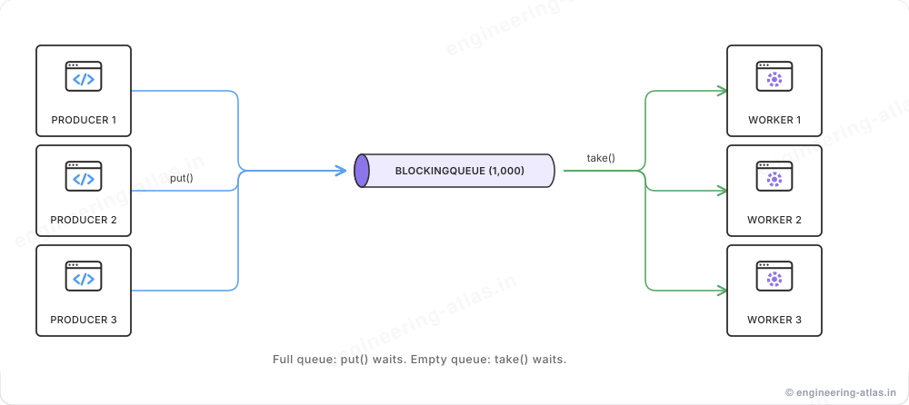</p>

| Topic | What it is, and why it matters | Free read |
|---|---|---|
| <a href="https://engineering-atlas.in/java/multithreading/executorservice-and-thread-pools/?utm_source=github&utm_medium=lld-roadmap&utm_campaign=java-executorservice-and-thread-pools">ExecutorService and thread pools</a><br><picture><source media="(prefers-color-scheme: dark)" srcset="diagrams/tags/beginner-dark.svg"></picture> | Reuse a fixed set of threads for many tasks instead of creating a thread per task. |  |
| <a href="https://engineering-atlas.in/java/multithreading/the-producer-consumer-problem/?utm_source=github&utm_medium=lld-roadmap&utm_campaign=java-the-producer-consumer-problem">The producer-consumer problem</a><br><picture><source media="(prefers-color-scheme: dark)" srcset="diagrams/tags/intermediate-dark.svg"></picture> | Producers add work to a shared buffer and consumers take it out, waiting when it is full or empty. A bounded queue gives you back-pressure for free. |  |
| <a href="https://engineering-atlas.in/java/multithreading/sizing-thread-pools/?utm_source=github&utm_medium=lld-roadmap&utm_campaign=java-sizing-thread-pools">Sizing thread pools</a><br><picture><source media="(prefers-color-scheme: dark)" srcset="diagrams/tags/intermediate-dark.svg"></picture> | CPU-bound work wants about one thread per core; work that waits on I/O wants more. Measure before you guess. |  |
| <a href="https://engineering-atlas.in/java/multithreading/scheduled-executors/?utm_source=github&utm_medium=lld-roadmap&utm_campaign=java-scheduled-executors">Scheduled executors</a><br><picture><source media="(prefers-color-scheme: dark)" srcset="diagrams/tags/intermediate-dark.svg"></picture> | Run a task after a delay or on a fixed rate. The building block for a task scheduler or a cache that expires entries. |  |

#### Deep dive: a bounded producer-consumer

`BlockingQueue` does the waiting for you: `put` blocks when the queue is full and `take` blocks when it is empty. A bounded queue means a slow consumer slows producers down instead of using up memory.

```java
BlockingQueue<String> queue = new ArrayBlockingQueue<>(1_000);
ExecutorService workers = Executors.newFixedThreadPool(4);

for (int i = 0; i < 4; i++) {
    workers.submit(() -> {
        while (!Thread.currentThread().isInterrupted()) {
            String job = queue.take();   // waits when empty
            process(job);
        }
        return null;
    });
}

queue.put("send-email:42");              // waits when full
```

What happens when the queue is full is a design choice, and interviewers like to ask it. `put` waits (back-pressure), `offer` returns `false` right away (drop or reject), and `offer` with a timeout is the middle ground.


### 20. Designing Thread-safe Classes

<picture><source media="(prefers-color-scheme: dark)" srcset="diagrams/banners/ch-20-dark.svg"></picture>

| | |
|---|---|
| **Why know this** | Knowing the tools is half of it. The other half is design: which class owns the lock, how big the critical section is, and how a retry avoids doing the work twice. |
| **What interviewers test** | Is your design correct when two users act at once, without one global lock? |
| **What you will cover** | Thread-safe classes · Choosing lock granularity · Concurrent collections in designs · Idempotency and retries in LLD |
| **Try this** | Make a seat booking method safe for concurrent calls, then measure throughput with one global lock versus one lock per show. |
| **Ready to move on when** | You can make a parking lot's `park()` safe under concurrent calls and explain why you locked per floor rather than the whole lot. |


| Topic | What it is, and why it matters | Free read |
|---|---|---|
| Thread-safe classes<br><picture><source media="(prefers-color-scheme: dark)" srcset="diagrams/tags/intermediate-dark.svg"></picture> | Keep shared state private, guard every access with the same lock, and prefer immutable objects that need no lock at all. |  |
| Choosing lock granularity<br><picture><source media="(prefers-color-scheme: dark)" srcset="diagrams/tags/intermediate-dark.svg"></picture> | One lock for everything is safe but slow; one lock per slot is fast but easy to get wrong. Lock at the level where conflicts really happen. |  |
| Concurrent collections in designs<br><picture><source media="(prefers-color-scheme: dark)" srcset="diagrams/tags/intermediate-dark.svg"></picture> | Where a `ConcurrentHashMap` or a `BlockingQueue` replaces a lock entirely in common LLD problems. |  |
| Idempotency and retries in LLD<br><picture><source media="(prefers-color-scheme: dark)" srcset="diagrams/tags/advanced-dark.svg"></picture> | A retried booking or payment must not happen twice. An idempotency key checked atomically makes repeats harmless. |  |


### Can you answer these?

1. Two users book the last seat at the same time. Walk through what your code does.
2. When is `volatile` enough, and when do you need a lock?
3. Why is `if (!map.containsKey(k)) map.put(k, v)` unsafe even on a `ConcurrentHashMap`?
4. Your logger blocks request threads while writing to disk. How do you fix it?

**Continue learning on Engineering Atlas:** [Java course: Multithreading and concurrency](https://engineering-atlas.in/java/multithreading/?utm_source=github&utm_medium=lld-roadmap&utm_campaign=java-multithreading)

<p align="right"><sub><a href="#contents">Back to contents ↑</a></sub></p>

---

## Part VII: LLD interview questions with solutions

<p align="center"><picture><source media="(prefers-color-scheme: dark)" srcset="diagrams/banners/part-7-dark.svg">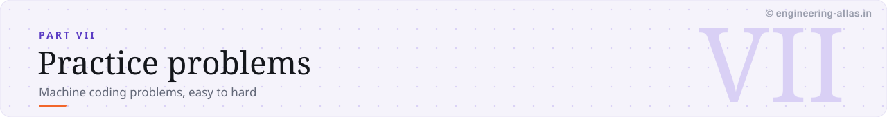</picture></p>

*Practice is where the earlier parts turn into skill.* Problems are ordered by difficulty, and each line says what the problem teaches, so you can pick the ones that cover your weak spots. Solve each in 60 to 90 minutes with runnable code before you open a solution.

> [!TIP]
> **How to practise.** Set a timer. Write requirements, draw the class diagram, write code that runs, then add one follow-up requirement and see how much code you had to touch. Less is better.

### Easy problems


| Problem | What it teaches | Level |
|---|---|---|
| <a href="https://engineering-atlas.in/lld/games-puzzles/design-tic-tac-toe/?utm_source=github&utm_medium=lld-roadmap&utm_campaign=lld-design-tic-tac-toe">Tic-tac-toe</a> | Board, players and turns. Teaches clean entities and an O(1) win check instead of scanning the board. | <picture><source media="(prefers-color-scheme: dark)" srcset="diagrams/tags/easy-dark.svg"></picture> |
| <a href="https://engineering-atlas.in/lld/data-structures/design-an-lru-cache/?utm_source=github&utm_medium=lld-roadmap&utm_campaign=lld-design-an-lru-cache">LRU cache</a> | A hash map plus a doubly linked list for O(1) get and put. The most asked LLD-meets-DSA question. | <picture><source media="(prefers-color-scheme: dark)" srcset="diagrams/tags/easy-dark.svg"></picture> |
| <a href="https://engineering-atlas.in/lld/messaging/design-a-logging-framework/?utm_source=github&utm_medium=lld-roadmap&utm_campaign=lld-design-a-logging-framework">Logging framework</a> | Log levels, formatters and multiple outputs. Teaches chain of responsibility, strategy and singleton in one small problem. | <picture><source media="(prefers-color-scheme: dark)" srcset="diagrams/tags/easy-dark.svg"></picture> |
| <a href="https://engineering-atlas.in/lld/developer-tools/design-a-url-shortener/?utm_source=github&utm_medium=lld-roadmap&utm_campaign=lld-design-a-url-shortener">URL shortener</a> | Key generation, collisions and expiry, in code rather than on a whiteboard. | <picture><source media="(prefers-color-scheme: dark)" srcset="diagrams/tags/easy-dark.svg"></picture> |
| <a href="https://engineering-atlas.in/lld/state-machines/design-a-vending-machine/?utm_source=github&utm_medium=lld-roadmap&utm_campaign=lld-design-a-vending-machine">Vending machine</a> | The textbook State pattern problem: idle, has money, dispensing, out of stock. | <picture><source media="(prefers-color-scheme: dark)" srcset="diagrams/tags/easy-dark.svg"></picture> |
| <a href="https://engineering-atlas.in/lld/management-systems/design-a-parking-lot/?utm_source=github&utm_medium=lld-roadmap&utm_campaign=lld-design-a-parking-lot">Parking lot</a> | Floors, slots, vehicle types, tickets and fees. The most common first LLD question, and the best one to learn the method on. | <picture><source media="(prefers-color-scheme: dark)" srcset="diagrams/tags/easy-dark.svg"></picture> |
| <a href="https://engineering-atlas.in/lld/games-puzzles/design-snake-and-ladder/?utm_source=github&utm_medium=lld-roadmap&utm_campaign=lld-design-snake-and-ladder">Snake and ladder</a> | Board setup, dice strategies and a game loop. Good practice in keeping the board separate from the rules. | <picture><source media="(prefers-color-scheme: dark)" srcset="diagrams/tags/easy-dark.svg"></picture> |
| Coffee vending machine | Recipes, ingredient stock and refills. Teaches inventory checks with concurrent orders. | <picture><source media="(prefers-color-scheme: dark)" srcset="diagrams/tags/easy-dark.svg"></picture> |
| Traffic signal controller | Timed state transitions and emergency overrides. | <picture><source media="(prefers-color-scheme: dark)" srcset="diagrams/tags/easy-dark.svg"></picture> |
| Minesweeper | Grid modelling and flood-fill reveal, with a clean split between board and game state. | <picture><source media="(prefers-color-scheme: dark)" srcset="diagrams/tags/easy-dark.svg"></picture> |


### Medium problems


| Problem | What it teaches | Level |
|---|---|---|
| <a href="https://engineering-atlas.in/lld/state-machines/design-an-elevator-system/?utm_source=github&utm_medium=lld-roadmap&utm_campaign=lld-design-an-elevator-system">Elevator system</a> | Requests, directions and a scheduling strategy across several cars. Teaches State plus Strategy together. | <picture><source media="(prefers-color-scheme: dark)" srcset="diagrams/tags/medium-dark.svg"></picture> |
| <a href="https://engineering-atlas.in/lld/management-systems/design-a-library-management-system/?utm_source=github&utm_medium=lld-roadmap&utm_campaign=lld-design-a-library-management-system">Library management system</a> | Books, copies, members, loans and fines. Teaches the difference between a catalogue entry and a physical item. | <picture><source media="(prefers-color-scheme: dark)" srcset="diagrams/tags/medium-dark.svg"></picture> |
| <a href="https://engineering-atlas.in/lld/messaging/design-a-notification-system/?utm_source=github&utm_medium=lld-roadmap&utm_campaign=lld-design-a-notification-system">Notification system</a> | Channels, templates, user preferences and retries. Observer, Strategy and a producer-consumer queue. | <picture><source media="(prefers-color-scheme: dark)" srcset="diagrams/tags/medium-dark.svg"></picture> |
| <a href="https://engineering-atlas.in/lld/ecommerce-booking/design-a-car-rental-system/?utm_source=github&utm_medium=lld-roadmap&utm_campaign=lld-design-a-car-rental-system">Car rental system</a> | Search by date range, reservations and pricing rules. Teaches overlap checks and booking lifecycles. | <picture><source media="(prefers-color-scheme: dark)" srcset="diagrams/tags/medium-dark.svg"></picture> |
| <a href="https://engineering-atlas.in/lld/ecommerce-booking/design-a-movie-ticket-booking-system/?utm_source=github&utm_medium=lld-roadmap&utm_campaign=lld-design-a-movie-ticket-booking-system">Movie ticket booking</a> | Shows, seats and temporary holds. The classic test of concurrent booking without double-selling. | <picture><source media="(prefers-color-scheme: dark)" srcset="diagrams/tags/medium-dark.svg"></picture> |
| <a href="https://engineering-atlas.in/lld/developer-tools/design-an-in-memory-file-system/?utm_source=github&utm_medium=lld-roadmap&utm_campaign=lld-design-an-in-memory-file-system">In-memory file system</a> | Directories and files as a tree. The Composite pattern, plus path parsing. | <picture><source media="(prefers-color-scheme: dark)" srcset="diagrams/tags/medium-dark.svg"></picture> |
| ATM | Card, PIN, cash dispensing by denomination. State plus chain of responsibility. | <picture><source media="(prefers-color-scheme: dark)" srcset="diagrams/tags/medium-dark.svg"></picture> |
| Pub-sub system | Topics, subscribers and delivery. Observer with threads and back-pressure. | <picture><source media="(prefers-color-scheme: dark)" srcset="diagrams/tags/medium-dark.svg"></picture> |
| Rate limiter | Token bucket and sliding window behind one interface, made thread-safe. | <picture><source media="(prefers-color-scheme: dark)" srcset="diagrams/tags/medium-dark.svg"></picture> |
| Task management system | Tasks, assignees, statuses and filters. Good Specification pattern practice. | <picture><source media="(prefers-color-scheme: dark)" srcset="diagrams/tags/medium-dark.svg"></picture> |
| Inventory management system | Stock across warehouses, reservations and low-stock alerts. | <picture><source media="(prefers-color-scheme: dark)" srcset="diagrams/tags/medium-dark.svg"></picture> |
| Shopping cart | Items, quantities, discounts and checkout. Strategy for promotions. | <picture><source media="(prefers-color-scheme: dark)" srcset="diagrams/tags/medium-dark.svg"></picture> |
| Amazon locker | Locker sizes, pickup codes and expiry. | <picture><source media="(prefers-color-scheme: dark)" srcset="diagrams/tags/medium-dark.svg"></picture> |
| Meeting scheduler | Rooms, calendars and interval overlap. | <picture><source media="(prefers-color-scheme: dark)" srcset="diagrams/tags/medium-dark.svg"></picture> |
| Task scheduler | One-off and recurring jobs on a thread pool with a priority queue. | <picture><source media="(prefers-color-scheme: dark)" srcset="diagrams/tags/medium-dark.svg"></picture> |
| In-memory key-value store | Get, put, delete, expiry and transactions. | <picture><source media="(prefers-color-scheme: dark)" srcset="diagrams/tags/medium-dark.svg"></picture> |
| Search autocomplete | A trie with top-k suggestions per prefix. | <picture><source media="(prefers-color-scheme: dark)" srcset="diagrams/tags/medium-dark.svg"></picture> |
| Chat application | Users, conversations, messages and read receipts. | <picture><source media="(prefers-color-scheme: dark)" srcset="diagrams/tags/medium-dark.svg"></picture> |
| Stack Overflow | Questions, answers, votes, reputation and tags. | <picture><source media="(prefers-color-scheme: dark)" srcset="diagrams/tags/medium-dark.svg"></picture> |
| Restaurant management system | Tables, orders, kitchen queue and bills. | <picture><source media="(prefers-color-scheme: dark)" srcset="diagrams/tags/medium-dark.svg"></picture> |
| Learning platform | Courses, enrolments and progress tracking. | <picture><source media="(prefers-color-scheme: dark)" srcset="diagrams/tags/medium-dark.svg"></picture> |
| Bloom filter | Bit arrays and hash functions, with a clear story on false positives. | <picture><source media="(prefers-color-scheme: dark)" srcset="diagrams/tags/medium-dark.svg"></picture> |


### Hard problems


| Problem | What it teaches | Level |
|---|---|---|
| <a href="https://engineering-atlas.in/lld/financial/design-splitwise/?utm_source=github&utm_medium=lld-roadmap&utm_campaign=lld-design-splitwise">Splitwise</a> | Expenses, split strategies and balance simplification. Teaches Strategy and careful money handling. | <picture><source media="(prefers-color-scheme: dark)" srcset="diagrams/tags/hard-dark.svg"></picture> |
| <a href="https://engineering-atlas.in/lld/games-puzzles/design-a-chess-game/?utm_source=github&utm_medium=lld-roadmap&utm_campaign=lld-design-a-chess-game">Chess</a> | Pieces, legal moves, check and checkmate. Polymorphism at its best, and a big model to keep clean. | <picture><source media="(prefers-color-scheme: dark)" srcset="diagrams/tags/hard-dark.svg"></picture> |
| <a href="https://engineering-atlas.in/lld/ecommerce-booking/design-urban-company/?utm_source=github&utm_medium=lld-roadmap&utm_campaign=lld-design-urban-company">Home services marketplace (Urban Company)</a> | Providers, slots, matching and booking states across two sides of a marketplace. | <picture><source media="(prefers-color-scheme: dark)" srcset="diagrams/tags/hard-dark.svg"></picture> |
| <a href="https://engineering-atlas.in/lld/financial/design-a-kyc-system/?utm_source=github&utm_medium=lld-roadmap&utm_campaign=lld-design-a-kyc-system">KYC system</a> | Document checks, verification steps and audit trails. Chain of responsibility and State. | <picture><source media="(prefers-color-scheme: dark)" srcset="diagrams/tags/hard-dark.svg"></picture> |
| Payment gateway | Payment methods, retries and idempotency, with a state machine per payment. | <picture><source media="(prefers-color-scheme: dark)" srcset="diagrams/tags/hard-dark.svg"></picture> |
| Online stock exchange | An order book that matches buy and sell orders by price and time. | <picture><source media="(prefers-color-scheme: dark)" srcset="diagrams/tags/hard-dark.svg"></picture> |
| Ride-hailing service | Drivers, riders, matching, trip states and fares. | <picture><source media="(prefers-color-scheme: dark)" srcset="diagrams/tags/hard-dark.svg"></picture> |
| Online food delivery | Restaurants, menus, orders, delivery partners and live status. | <picture><source media="(prefers-color-scheme: dark)" srcset="diagrams/tags/hard-dark.svg"></picture> |
| Online auction system | Bids, auction timers and concurrent highest-bid updates. | <picture><source media="(prefers-color-scheme: dark)" srcset="diagrams/tags/hard-dark.svg"></picture> |
| Online shopping system (Amazon) | Catalogue, cart, orders, payments and shipping in one model. | <picture><source media="(prefers-color-scheme: dark)" srcset="diagrams/tags/hard-dark.svg"></picture> |
| Version control system | Commits, branches and merges as an object graph. | <picture><source media="(prefers-color-scheme: dark)" srcset="diagrams/tags/hard-dark.svg"></picture> |
| Twitter | Users, tweets, follows and a timeline in memory. | <picture><source media="(prefers-color-scheme: dark)" srcset="diagrams/tags/hard-dark.svg"></picture> |
| LinkedIn | Profiles, connections, posts and job applications. | <picture><source media="(prefers-color-scheme: dark)" srcset="diagrams/tags/hard-dark.svg"></picture> |
| Spotify | Tracks, playlists, playback queue and shuffle strategies. | <picture><source media="(prefers-color-scheme: dark)" srcset="diagrams/tags/hard-dark.svg"></picture> |
| Cricinfo | Matches, innings, balls and live scorecards. | <picture><source media="(prefers-color-scheme: dark)" srcset="diagrams/tags/hard-dark.svg"></picture> |
| Simple search engine | An inverted index with ranking. | <picture><source media="(prefers-color-scheme: dark)" srcset="diagrams/tags/hard-dark.svg"></picture> |


### Solution outlines for six classic problems

Try each one on your own first. Then open the outline to check your direction, and the full solution for the class diagram, code and follow-ups.

<details>
<summary><b>Parking lot</b> &nbsp;·&nbsp; <a href="https://engineering-atlas.in/lld/management-systems/design-a-parking-lot/?utm_source=github&utm_medium=lld-roadmap&utm_campaign=lld-design-a-parking-lot">Full solution →</a></summary>

| | |
|---|---|
| **Core classes** | `ParkingLot`, `Floor`, `Slot`, `Vehicle`, `Ticket`, enums `VehicleType` and `SlotSize`. |
| **Patterns** | Strategy for pricing and slot allocation; Factory for vehicles; Singleton avoided by passing the lot in. |
| **Concurrency** | Two gates must not claim one slot: lock per floor or compare-and-set on the slot. |
| **Follow-ups** | EV charging slots, weekend pricing, a display board per floor (Observer). |

</details>

<details>
<summary><b>LRU cache</b> &nbsp;·&nbsp; <a href="https://engineering-atlas.in/lld/data-structures/design-an-lru-cache/?utm_source=github&utm_medium=lld-roadmap&utm_campaign=lld-design-an-lru-cache">Full solution →</a></summary>

| | |
|---|---|
| **Core classes** | `LRUCache<K, V>` with a `HashMap` and a doubly linked list of `Node`s, dummy head and tail. |
| **Key idea** | The map finds the node in O(1); the list keeps recency, so eviction is "remove before tail". |
| **Concurrency** | Every `get` writes, so one lock around both methods; striping by key for higher load. |
| **Follow-ups** | TTL per entry, LFU instead of LRU, a pluggable eviction policy (Strategy). |

</details>

<details>
<summary><b>Vending machine</b> &nbsp;·&nbsp; <a href="https://engineering-atlas.in/lld/state-machines/design-a-vending-machine/?utm_source=github&utm_medium=lld-roadmap&utm_campaign=lld-design-a-vending-machine">Full solution →</a></summary>

| | |
|---|---|
| **Core classes** | `VendingMachine`, `Inventory`, `Product`, `Coin` enum, a `State` interface with one class per state. |
| **Patterns** | State for the lifecycle; Strategy for change-making if coin sets vary. |
| **Edge cases** | Sold out mid-transaction, exact change unavailable, cancel after inserting coins. |
| **Follow-ups** | Card payments (new payment strategy), maintenance mode (new state). |

</details>

<details>
<summary><b>Elevator system</b> &nbsp;·&nbsp; <a href="https://engineering-atlas.in/lld/state-machines/design-an-elevator-system/?utm_source=github&utm_medium=lld-roadmap&utm_campaign=lld-design-an-elevator-system">Full solution →</a></summary>

| | |
|---|---|
| **Core classes** | `ElevatorSystem`, `Elevator`, `Request`, `Direction` enum, `Door`, a `Scheduler` interface. |
| **Patterns** | State for each car (moving up, moving down, idle, doors open); Strategy for scheduling. |
| **Key idea** | Each car keeps sorted stops in its direction of travel (the LOOK algorithm), like a lift really works. |
| **Follow-ups** | Express cars, maintenance mode, a different scheduler for peak hours. |

</details>

<details>
<summary><b>Movie ticket booking</b> &nbsp;·&nbsp; <a href="https://engineering-atlas.in/lld/ecommerce-booking/design-a-movie-ticket-booking-system/?utm_source=github&utm_medium=lld-roadmap&utm_campaign=lld-design-a-movie-ticket-booking-system">Full solution →</a></summary>

| | |
|---|---|
| **Core classes** | `Cinema`, `Screen`, `Show`, `Seat`, `Booking`, `Payment`, `SeatHold`. |
| **Key idea** | Seats are held for a few minutes during payment, then confirmed or released. |
| **Concurrency** | Holding seats is a compare-and-set per seat, or a lock per show; never one global lock. |
| **Follow-ups** | Seat categories and pricing, cancellations and refunds, notifications on confirm. |

</details>

<details>
<summary><b>Splitwise</b> &nbsp;·&nbsp; <a href="https://engineering-atlas.in/lld/financial/design-splitwise/?utm_source=github&utm_medium=lld-roadmap&utm_campaign=lld-design-splitwise">Full solution →</a></summary>

| | |
|---|---|
| **Core classes** | `User`, `Group`, `Expense`, `Split`, `BalanceSheet`, a `SplitStrategy` interface. |
| **Patterns** | Strategy for equal, exact and percentage splits; Factory to build the right split. |
| **Key idea** | Store money in the smallest unit (paise or cents) to avoid floating-point errors. |
| **Follow-ups** | Simplify debts across a group with a greedy pass over net balances. |

</details>

**Continue learning on Engineering Atlas:** [All LLD problems](https://engineering-atlas.in/lld/?utm_source=github&utm_medium=lld-roadmap&utm_campaign=lld)

<p align="right"><sub><a href="#contents">Back to contents ↑</a></sub></p>

---

## Part VIII: The LLD interview

<p align="center"><picture><source media="(prefers-color-scheme: dark)" srcset="diagrams/banners/part-8-dark.svg">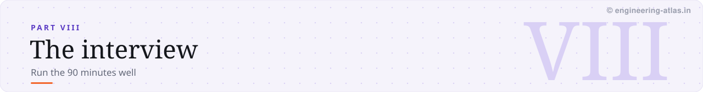</picture></p>

*Knowing the material and passing the round are different skills.* This part is about running the 60 to 90 minutes: what to ask, what to draw, what to code first, and what reviewers mark you down for.

### 21. The Method and the Clock

<picture><source media="(prefers-color-scheme: dark)" srcset="diagrams/banners/ch-21-dark.svg"></picture>

<a href="https://engineering-atlas.in/lld/introduction/?utm_source=github&utm_medium=lld-roadmap&utm_campaign=lld-introduction"><picture><source media="(prefers-color-scheme: dark)" srcset="diagrams/banners/btn-chapter-dark.svg"></picture></a>

| | |
|---|---|
| **Why know this** | Candidates who know every pattern still fail by spending 40 minutes on the class diagram and never running their code. A fixed method and a time budget stop that. |
| **What interviewers test** | Do you follow a method and have running code well before time runs out? |
| **What you will cover** | The LLD interview framework · Managing the clock |
| **Try this** | Do a timed 90-minute parking lot round. Note the minute your code first runs end to end. |
| **Ready to move on when** | You can say the six steps of the method and how many minutes each one gets in a 90-minute machine coding round. |


| Topic | What it is, and why it matters | Free read |
|---|---|---|
| <a href="https://engineering-atlas.in/lld/introduction/the-lld-interview-framework/?utm_source=github&utm_medium=lld-roadmap&utm_campaign=lld-the-lld-interview-framework">The LLD interview framework</a><br><picture><source media="(prefers-color-scheme: dark)" srcset="diagrams/tags/beginner-dark.svg"></picture> | Requirements, entities, relationships, class diagram, code, then extensions. The same order for every problem. |  |
| <a href="https://engineering-atlas.in/lld/introduction/managing-the-clock/?utm_source=github&utm_medium=lld-roadmap&utm_campaign=lld-managing-the-clock">Managing the clock</a><br><picture><source media="(prefers-color-scheme: dark)" srcset="diagrams/tags/beginner-dark.svg"></picture> | Get something running by the halfway mark, then improve it. Working code with one gap beats a perfect design that doesn't compile. |  |


### 22. From Requirements to Code

<picture><source media="(prefers-color-scheme: dark)" srcset="diagrams/banners/ch-22-dark.svg"></picture>

<a href="https://engineering-atlas.in/lld/interview-tips/?utm_source=github&utm_medium=lld-roadmap&utm_campaign=lld-interview-tips"><picture><source media="(prefers-color-scheme: dark)" srcset="diagrams/banners/btn-chapter-dark.svg"></picture></a>

| | |
|---|---|
| **Why know this** | The first 15 minutes decide the rest. Good questions shrink the problem; a clean entity list makes the class diagram obvious; a planned order of coding keeps you out of dead ends. |
| **What interviewers test** | Do you ask the right questions and turn the answers into the right classes? |
| **What you will cover** | Clarifying requirements in LLD · Identifying entities and relationships · From class diagram to code |
| **Try this** | Take the prompt "design Splitwise", write five requirements and the entity list, and stop before drawing anything. |
| **Ready to move on when** | You can turn a one-line prompt into five requirements, pick out the nouns and verbs, and write the core classes in the right order. |


| Topic | What it is, and why it matters | Free read |
|---|---|---|
| <a href="https://engineering-atlas.in/lld/interview-tips/clarifying-requirements-in-lld/?utm_source=github&utm_medium=lld-roadmap&utm_campaign=lld-clarifying-requirements-in-lld">Clarifying requirements in LLD</a><br><picture><source media="(prefers-color-scheme: dark)" srcset="diagrams/tags/beginner-dark.svg"></picture> | Ask about actors, the main use cases, and what is out of scope. Write the answers down where the interviewer can see them. |  |
| <a href="https://engineering-atlas.in/lld/interview-tips/identifying-entities-and-relationships/?utm_source=github&utm_medium=lld-roadmap&utm_campaign=lld-identifying-entities-and-relationships">Identifying entities and relationships</a><br><picture><source media="(prefers-color-scheme: dark)" srcset="diagrams/tags/intermediate-dark.svg"></picture> | Nouns become candidate classes, verbs become methods, and "has" or "is a" become relationships. Then remove anything that has no behaviour. |  |
| <a href="https://engineering-atlas.in/lld/interview-tips/from-class-diagram-to-code/?utm_source=github&utm_medium=lld-roadmap&utm_campaign=lld-from-class-diagram-to-code">From class diagram to code</a><br><picture><source media="(prefers-color-scheme: dark)" srcset="diagrams/tags/intermediate-dark.svg"></picture> | Start with enums and value objects, then entities, then services, then the demo `main`. Each layer compiles before the next. |  |


### 23. What Reviewers Grade, and Common Mistakes

<picture><source media="(prefers-color-scheme: dark)" srcset="diagrams/banners/ch-23-dark.svg"></picture>

<a href="https://engineering-atlas.in/lld/interview-tips/?utm_source=github&utm_medium=lld-roadmap&utm_campaign=lld-interview-tips"><picture><source media="(prefers-color-scheme: dark)" srcset="diagrams/banners/btn-chapter-dark.svg"></picture></a>

| | |
|---|---|
| **Why know this** | Machine coding rounds are often scored on a rubric. Knowing the rubric tells you where to spend the last 20 minutes, and the common mistakes list is a checklist you can run before you say "done". |
| **What interviewers test** | Can you review your own code against the rubric before the interviewer does? |
| **What you will cover** | What reviewers grade · Common LLD mistakes · LLD interview questions |
| **Try this** | Review one of your old solutions against the "what reviewers grade" list and fix the two weakest points. |
| **Ready to move on when** | You can review your own solution against the rubric and fix the two weakest points in 15 minutes. |


| Topic | What it is, and why it matters | Free read |
|---|---|---|
| <a href="https://engineering-atlas.in/lld/interview-tips/what-reviewers-grade/?utm_source=github&utm_medium=lld-roadmap&utm_campaign=lld-what-reviewers-grade">What reviewers grade</a><br><picture><source media="(prefers-color-scheme: dark)" srcset="diagrams/tags/beginner-dark.svg"></picture> | Working code, separation of concerns, extensibility, naming, error handling and tests, roughly in that order. |  |
| <a href="https://engineering-atlas.in/lld/interview-tips/common-lld-mistakes/?utm_source=github&utm_medium=lld-roadmap&utm_campaign=lld-common-lld-mistakes">Common LLD mistakes</a><br><picture><source media="(prefers-color-scheme: dark)" srcset="diagrams/tags/beginner-dark.svg"></picture> | God classes, public fields, `switch` on type, logic in `main`, no handling for invalid input, and patterns added for show. |  |
| <a href="https://engineering-atlas.in/lld/interview-tips/lld-interview-questions/?utm_source=github&utm_medium=lld-roadmap&utm_campaign=lld-lld-interview-questions">LLD interview questions</a><br><picture><source media="(prefers-color-scheme: dark)" srcset="diagrams/tags/intermediate-dark.svg"></picture> | The concept questions asked alongside the problem: SOLID, patterns, relationships and concurrency, with short model answers. |  |


### 24. Testing Your Design

<picture><source media="(prefers-color-scheme: dark)" srcset="diagrams/banners/ch-24-dark.svg"></picture>

<a href="https://engineering-atlas.in/java/testing/?utm_source=github&utm_medium=lld-roadmap&utm_campaign=java-testing"><picture><source media="(prefers-color-scheme: dark)" srcset="diagrams/banners/btn-chapter-dark.svg"></picture></a>

| | |
|---|---|
| **Why know this** | A design is only as good as how easily you can test it. Interviewers who ask "how would you test this?" are checking for dependency injection and small classes, not for test syntax. |
| **What interviewers test** | Is your design easy to test, and can you show how? |
| **What you will cover** | Unit testing in Java with JUnit 5 · Writing testable code · Stubs, mocks, spies and fakes |
| **Try this** | Write three JUnit tests for a parking fee calculator using an injected `Clock`, covering the first hour, a full day and overnight. |
| **Ready to move on when** | You can write a JUnit test for your fee calculator with a fake clock, and explain why constructor injection made that possible. |


| Topic | What it is, and why it matters | Free read |
|---|---|---|
| <a href="https://engineering-atlas.in/java/testing/unit-testing-in-java-with-junit-5/?utm_source=github&utm_medium=lld-roadmap&utm_campaign=java-unit-testing-in-java-with-junit-5">Unit testing in Java with JUnit 5</a><br><picture><source media="(prefers-color-scheme: dark)" srcset="diagrams/tags/beginner-dark.svg"></picture> | Arrange, act, assert. One behaviour per test, named after what it proves. | <a href="https://junit.org/junit5/docs/current/user-guide/">JUnit 5 user guide</a> |
| Writing testable code<br><picture><source media="(prefers-color-scheme: dark)" srcset="diagrams/tags/intermediate-dark.svg"></picture> | Inject time, randomness and storage so a test can control them. Hidden `new` and static calls are what make code hard to test. |  |
| Stubs, mocks, spies and fakes<br><picture><source media="(prefers-color-scheme: dark)" srcset="diagrams/tags/intermediate-dark.svg"></picture> | Four kinds of test double and when each one is the right choice. A hand-written fake is often clearer than a mock. |  |


### Can you answer these?

1. You have 90 minutes. At what minute should your code first run end to end?
2. Which three questions do you always ask before drawing anything?
3. Name four mistakes a reviewer looks for in the first two minutes of reading your code.
4. How would you test a parking fee calculator that depends on the current time?

**Continue learning on Engineering Atlas:** [LLD course: Interview tips](https://engineering-atlas.in/lld/interview-tips/?utm_source=github&utm_medium=lld-roadmap&utm_campaign=lld-interview-tips)

<p align="right"><sub><a href="#contents">Back to contents ↑</a></sub></p>

---

## How to answer an LLD interview question

Use the same six steps for every problem. The order matters more than the speed: each step makes the next one easier, and the interviewer can follow your thinking.

<p align="center">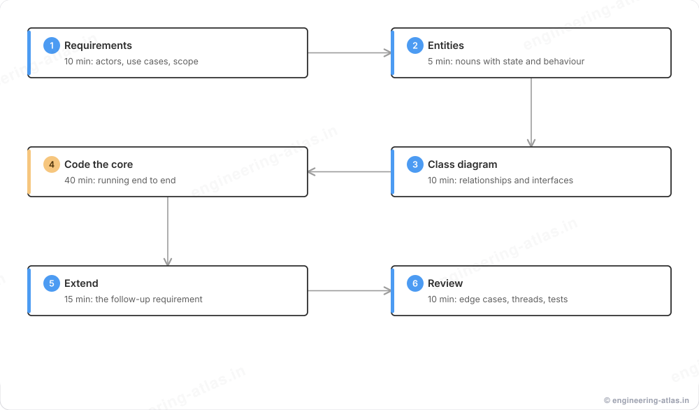</p>

1. **Requirements (about 10 minutes).** Ask who the actors are and what they do. Write 4 to 6 functional requirements and say what is out of scope. Ask about concurrency: "Can two users do this at once?"
2. **Entities (about 5 minutes).** Underline the nouns. Keep the ones with state and behaviour; drop the ones that are only a field.
3. **Relationships and class diagram (about 10 minutes).** Draw the classes, the lines between them and the main methods. Mark the interfaces where change is likely.
4. **Code the core (about 40 minutes).** Enums and value objects first, then entities, then services, then a `main` that runs the main use case. Get it running before you polish it.
5. **Extend (about 15 minutes).** Add the follow-up the interviewer gives you. If your design is good, this is a new class, not a rewrite.
6. **Review (about 10 minutes).** Walk through edge cases, thread safety and how you would test it. Name the trade-offs you made.

> [!TIP]
> **Say the pattern after the problem.** "Fees differ by vehicle type and will change, so I'll put pricing behind a `PricingStrategy` interface." Naming the reason first shows judgement; naming the pattern first sounds like a checklist.

### The method in action: three worked examples

Short on purpose. Each shows what you would say, draw and code at each step. Try the problem yourself first.

<details>
<summary><b>Worked example 1: Parking lot</b></summary>

| Step | What you do |
|---|---|
| **Requirements** | Several floors; slots for bikes, cars and trucks; issue a ticket on entry; charge by the hour on exit. Out of scope: reservations, online payment. Many gates work at once. |
| **Entities** | `ParkingLot`, `Floor`, `Slot`, `Vehicle`, `Ticket`, plus enums `VehicleType` and `SlotSize`. "Gate" and "fee" become services: `EntryService`, `PricingStrategy`. |
| **Class diagram** | `ParkingLot` composes `Floor`s; `Floor` composes `Slot`s; `Ticket` associates a `Vehicle` with a `Slot`. `PricingStrategy` is an interface with `HourlyPricing`; `SlotAllocator` is an interface with `NearestFirstAllocator`. |
| **Code the core** | `park(vehicle)` asks the allocator for a free slot, marks it taken and returns a `Ticket`. `unpark(ticket)` frees the slot and returns the fee from the pricing strategy. |
| **Extend** | "Add electric vehicle charging slots": a new `SlotSize` value and allocator rule; `ParkingLot` doesn't change. "Weekend pricing": a new `PricingStrategy`. |
| **Review** | Two gates must never get the same slot: lock per floor, or claim a slot with an atomic compare-and-set. Test pricing with a fake clock. |

<p align="center">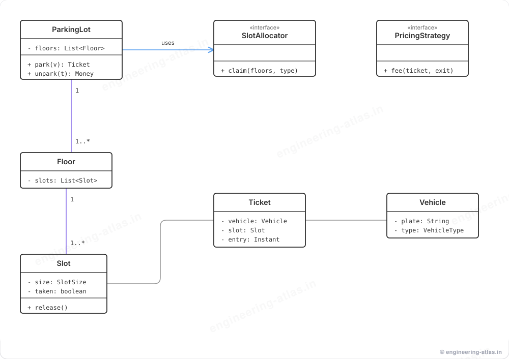</p>

```java
public interface PricingStrategy {
    Money fee(Ticket ticket, Instant exitTime);
}

public final class ParkingLot {
    private final List<Floor> floors;
    private final SlotAllocator allocator;
    private final PricingStrategy pricing;

    public ParkingLot(List<Floor> floors, SlotAllocator allocator, PricingStrategy pricing) {
        this.floors = List.copyOf(floors);
        this.allocator = allocator;
        this.pricing = pricing;
    }

    public Ticket park(Vehicle vehicle) {
        Slot slot = allocator.claim(floors, vehicle.type())
                .orElseThrow(() -> new LotFullException(vehicle.type()));
        return new Ticket(vehicle, slot, Instant.now());
    }

    public Money unpark(Ticket ticket, Instant exitTime) {
        ticket.slot().release();
        return pricing.fee(ticket, exitTime);
    }
}
```

</details>

<details>
<summary><b>Worked example 2: LRU cache</b></summary>

| Step | What you do |
|---|---|
| **Requirements** | `get(key)` and `put(key, value)` in O(1). Fixed capacity; when full, evict the least recently used entry. Ask: does it need to be thread-safe? (Say yes for the follow-up.) |
| **Entities** | `LRUCache<K, V>` and a private `Node<K, V>` with `prev` and `next`. No more: this problem rewards a small model. |
| **Class diagram** | `LRUCache` holds a `HashMap<K, Node>` for lookup and a doubly linked list for recency, with dummy head and tail nodes so there are no null checks. |
| **Code the core** | `get` moves the node to the front. `put` updates or inserts at the front, and if over capacity removes the node before the tail and its map entry. |
| **Extend** | "Make it thread-safe": one lock around `get` and `put` is correct and simple; mention that every `get` writes (it moves a node), so a read-write lock doesn't help. "Add TTL": store an expiry per node and check it on `get`. |
| **Review** | Edge cases: capacity 1, updating an existing key, `get` on a missing key. In Java, `LinkedHashMap` with access order does this in a few lines; say so, then write it by hand if asked. |

<p align="center">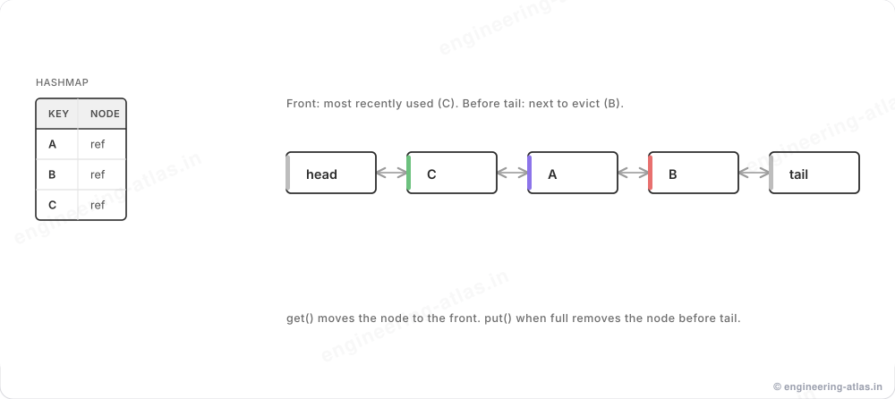</p>

```java
public final class LRUCache<K, V> {
    private final int capacity;
    private final Map<K, Node<K, V>> map = new HashMap<>();
    private final Node<K, V> head = new Node<>(null, null), tail = new Node<>(null, null);

    public LRUCache(int capacity) {
        this.capacity = capacity;
        head.next = tail; tail.prev = head;
    }

    public synchronized Optional<V> get(K key) {
        Node<K, V> n = map.get(key);
        if (n == null) return Optional.empty();
        unlink(n); addFront(n);
        return Optional.of(n.value);
    }

    public synchronized void put(K key, V value) {
        Node<K, V> n = map.get(key);
        if (n != null) { n.value = value; unlink(n); addFront(n); return; }
        if (map.size() == capacity) { Node<K, V> lru = tail.prev; unlink(lru); map.remove(lru.key); }
        n = new Node<>(key, value); map.put(key, n); addFront(n);
    }

    private void unlink(Node<K, V> n) { n.prev.next = n.next; n.next.prev = n.prev; }
    private void addFront(Node<K, V> n) { n.next = head.next; n.prev = head; head.next.prev = n; head.next = n; }

    private static final class Node<K, V> {
        final K key; V value; Node<K, V> prev, next;
        Node(K key, V value) { this.key = key; this.value = value; }
    }
}
```

</details>

<details>
<summary><b>Worked example 3: Vending machine</b></summary>

| Step | What you do |
|---|---|
| **Requirements** | Select a product, insert coins, dispense the product and return change. Cancel returns the money. Out of scope: card payments, remote monitoring. |
| **Entities** | `VendingMachine`, `Product`, `Inventory`, `Coin` (enum), and one class per state. |
| **Class diagram** | `VendingMachine` holds a current `State`. `State` is an interface with `selectProduct`, `insertCoin`, `dispense` and `cancel`. `IdleState`, `HasMoneyState`, `DispensingState` and `SoldOutState` implement it. |
| **Code the core** | Each state handles the events that are legal for it and throws `IllegalStateException` for the rest. Transitions happen by setting the machine's next state. |
| **Extend** | "Add a maintenance mode": one new state class; no existing state changes except the one that enters it. |
| **Review** | Change-making is a greedy pass over coin values from largest to smallest; say when greedy fails (unusual coin sets). Only one customer at a time, so a single lock on the machine is enough. |

<p align="center">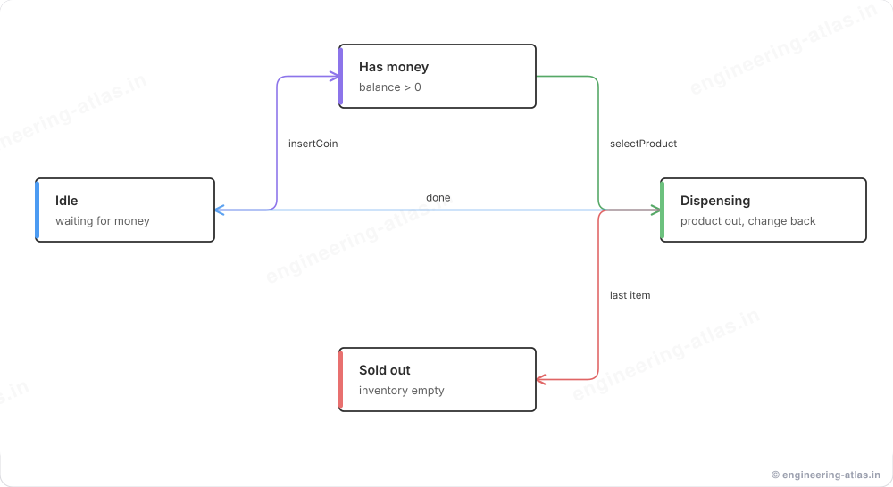</p>

```java
interface State {
    void insertCoin(VendingMachine m, Coin coin);
    void selectProduct(VendingMachine m, String code);
    void cancel(VendingMachine m);
}

final class IdleState implements State {
    public void insertCoin(VendingMachine m, Coin coin) {
        m.addToBalance(coin);
        m.setState(new HasMoneyState());
    }
    public void selectProduct(VendingMachine m, String code) {
        throw new IllegalStateException("Insert money first");
    }
    public void cancel(VendingMachine m) { /* nothing to return */ }
}
```

</details>

<p align="right"><sub><a href="#contents">Back to contents ↑</a></sub></p>

## Appendix: cheat sheets

### Which pattern when

| You hear | Reach for | Because |
|---|---|---|
| "Pricing differs by type and will change" | Strategy | Each rule is a class; add one without editing the others. |
| "Notify users when X happens" | Observer | Subscribers come and go without the subject knowing who they are. |
| "It behaves differently in each status" | State | Each status is a class; illegal moves are caught in one place. |
| "Support undo" | Command or Memento | Command records the action; Memento records the state. |
| "Plug in this third-party SDK" | Adapter | Wrap it to fit your own interface. |
| "Add logging or caching around it" | Decorator or Proxy | Decorator adds behaviour; Proxy controls access. |
| "Create objects by type from config" | Factory method | One place decides which class to build. |
| "An object with many optional fields" | Builder | Readable construction without a nine-argument constructor. |
| "Files inside folders inside folders" | Composite | Treat one item and a group the same way. |
| "Pass it along until someone handles it" | Chain of responsibility | Handlers are added or reordered without touching the sender. |
| "One simple call over a messy subsystem" | Facade | Callers see one method; the subsystem stays free to change. |
| "Exactly one instance" | Singleton, or better, one instance passed in | A singleton hides the dependency; injection keeps it visible and testable. |

### SOLID in one table

| Principle | The question it asks | Smell when it is broken |
|---|---|---|
| Single responsibility | Does this class have one reason to change? | A class named `Manager` with 30 methods |
| Open/closed | Can I add a case without editing working code? | A growing `switch` on type |
| Liskov substitution | Can every subclass stand in for its parent? | A subclass that throws `UnsupportedOperationException` |
| Interface segregation | Does every implementer use every method? | Empty method bodies to satisfy an interface |
| Dependency inversion | Does high-level code depend on interfaces? | `new MySqlRepository()` inside business logic |

### Java collections for LLD

| You need | Use | Get / insert | Notes |
|---|---|---|---|
| Lookup by key | `HashMap` | O(1) / O(1) | No order. Keys need good `equals` and `hashCode`. |
| Lookup by key, sorted | `TreeMap` | O(log n) / O(log n) | `floorKey` and `ceilingKey` for ranges and time slots. |
| Insertion or access order | `LinkedHashMap` | O(1) / O(1) | Access order plus `removeEldestEntry` is an LRU cache. |
| Unique items | `HashSet` / `TreeSet` | O(1) / O(log n) | `TreeSet` keeps them sorted. |
| Next smallest or largest | `PriorityQueue` | O(log n) insert and remove, O(1) peek | Schedulers, nearest slot, top-k. |
| Queue or stack | `ArrayDeque` | O(1) at both ends | Faster than `Stack` and `LinkedList`. |
| Fixed set of keys from an enum | `EnumMap` | O(1) | Compact and ordered by the enum. |
| Shared map between threads | `ConcurrentHashMap` | O(1) | Use `computeIfAbsent` and `merge` for atomic updates. |
| Hand-off between threads | `ArrayBlockingQueue` | O(1) | Bounded, so producers wait when consumers fall behind. |

### The relationship lines

| Relationship | UML line | Read it as | Example |
|---|---|---|---|
| Inheritance | Solid line, hollow triangle | "is a" | `Car` is a `Vehicle` |
| Realization | Dashed line, hollow triangle | "implements" | `UpiPayment` implements `PaymentMethod` |
| Composition | Solid line, filled diamond | "owns, and dies with" | `Floor` owns its `Slot`s |
| Aggregation | Solid line, hollow diamond | "has, but doesn't own" | `Team` has `Player`s |
| Association | Solid line | "works with" | `Driver` works with `Ride` |
| Dependency | Dashed arrow | "uses for a moment" | `Checkout` uses `Receipt` as a parameter |

<p align="right"><sub><a href="#contents">Back to contents ↑</a></sub></p>

## Glossary

The terms you will hear in every LLD round, in one line each. Follow the arrow to the chapter that teaches it.

<p align="center"><a href="#glossary-a">A</a> · <a href="#glossary-b">B</a> · <a href="#glossary-c">C</a> · <a href="#glossary-d">D</a> · <a href="#glossary-e">E</a> · <a href="#glossary-f">F</a> · <a href="#glossary-g">G</a> · <a href="#glossary-i">I</a> · <a href="#glossary-k">K</a> · <a href="#glossary-l">L</a> · <a href="#glossary-m">M</a> · <a href="#glossary-o">O</a> · <a href="#glossary-p">P</a> · <a href="#glossary-r">R</a> · <a href="#glossary-s">S</a> · <a href="#glossary-t">T</a> · <a href="#glossary-v">V</a> · <a href="#glossary-y">Y</a></p>

| Term | Meaning | Learn it in |
|---|---|---|
| <a id="glossary-a"></a>**Abstraction** | Showing what an object does while hiding how it does it. | [Chapter 04 →](#04-the-four-pillars-of-oop) |
| **Adapter** | A wrapper that makes one interface fit another. | [Chapter 12 →](#12-structural-patterns) |
| **Aggregation** | A "has-a" relationship where the part can outlive the whole. | [Chapter 05 →](#05-class-relationships) |
| **Association** | Two classes that know about and work with each other. | [Chapter 05 →](#05-class-relationships) |
| **Atomic operation** | An operation other threads see as all done or not started. | [Chapter 18 →](#18-atomics-and-concurrent-collections) |
| <a id="glossary-b"></a>**Builder** | A pattern that builds a complex object step by step. | [Chapter 11 →](#11-creational-patterns) |
| <a id="glossary-c"></a>**Chain of responsibility** | Handlers passing a request along until one handles it. | [Chapter 13 →](#13-behavioural-patterns-the-everyday-six) |
| **Class diagram** | A UML picture of classes, their members and their relationships. | [Chapter 09 →](#09-class-diagrams) |
| **Cohesion** | How closely the parts of one class belong together. | [Chapter 07 →](#07-coupling-cohesion-and-composition) |
| **Command** | A request wrapped as an object so it can be queued, logged or undone. | [Chapter 13 →](#13-behavioural-patterns-the-everyday-six) |
| **Composite** | Treating single objects and groups of objects the same way. | [Chapter 12 →](#12-structural-patterns) |
| **Composition** | A strong "has-a": the part is created and destroyed with the whole. | [Chapter 05 →](#05-class-relationships) |
| **Coupling** | How much one class depends on the details of another. | [Chapter 07 →](#07-coupling-cohesion-and-composition) |
| <a id="glossary-d"></a>**Deadlock** | Threads waiting on each other's locks forever. | [Chapter 17 →](#17-locks-and-visibility) |
| **Decorator** | A wrapper that adds behaviour to an object at runtime. | [Chapter 12 →](#12-structural-patterns) |
| **Dependency injection** | Passing collaborators in from outside instead of creating them inside. | [Chapter 15 →](#15-patterns-beyond-the-classic-23) |
| **Dependency inversion** | High-level code depends on interfaces, not concrete classes. | [Chapter 08 →](#08-solid-principles) |
| **DRY** | "Don't repeat yourself": each piece of knowledge lives in one place. | [Chapter 06 →](#06-everyday-design-principles) |
| <a id="glossary-e"></a>**Encapsulation** | Keeping state private and changing it only through methods. | [Chapter 04 →](#04-the-four-pillars-of-oop) |
| **Enum** | A type with a fixed set of named values. | [Chapter 03 →](#03-classes-objects-enums-and-interfaces) |
| <a id="glossary-f"></a>**Facade** | One simple entry point over a complicated subsystem. | [Chapter 12 →](#12-structural-patterns) |
| **Factory method** | A method that decides which concrete class to create. | [Chapter 11 →](#11-creational-patterns) |
| <a id="glossary-g"></a>**God class** | One class that knows and does too much. The most common LLD mistake. | [Chapter 23 →](#23-what-reviewers-grade-and-common-mistakes) |
| <a id="glossary-i"></a>**Idempotency** | Doing an operation twice has the same effect as doing it once. | [Chapter 20 →](#20-designing-thread-safe-classes) |
| **Immutable object** | An object whose state can't change after it is built. | [Chapter 02 →](#02-the-java-you-need-for-lld) |
| **Inheritance** | A class reusing and extending another class. | [Chapter 04 →](#04-the-four-pillars-of-oop) |
| **Interface** | A contract that says what a type can do, with no state. | [Chapter 03 →](#03-classes-objects-enums-and-interfaces) |
| **Interface segregation** | Many small interfaces instead of one large one. | [Chapter 08 →](#08-solid-principles) |
| <a id="glossary-k"></a>**KISS** | "Keep it simple": pick the plainest design that works. | [Chapter 06 →](#06-everyday-design-principles) |
| <a id="glossary-l"></a>**Law of Demeter** | Talk only to your direct collaborators, not their collaborators. | [Chapter 06 →](#06-everyday-design-principles) |
| **Liskov substitution** | A subclass must work anywhere its parent does. | [Chapter 08 →](#08-solid-principles) |
| **Lock granularity** | How much data one lock protects: the whole object or one part. | [Chapter 20 →](#20-designing-thread-safe-classes) |
| <a id="glossary-m"></a>**Machine coding** | An interview round where you write runnable code for a design in 60 to 120 minutes. | [Chapter 01 →](#01-what-low-level-design-is) |
| **Memento** | A saved snapshot of an object's state, used for undo. | [Chapter 14 →](#14-behavioural-patterns-the-specialists) |
| **Multiplicity** | The numbers on a UML line, like `1` and `0..*`. | [Chapter 09 →](#09-class-diagrams) |
| <a id="glossary-o"></a>**Observer** | Subscribers notified automatically when a subject changes. | [Chapter 13 →](#13-behavioural-patterns-the-everyday-six) |
| **Open/closed** | Open for extension, closed for modification. | [Chapter 08 →](#08-solid-principles) |
| <a id="glossary-p"></a>**Polymorphism** | One call that behaves differently depending on the object's type. | [Chapter 04 →](#04-the-four-pillars-of-oop) |
| **Producer-consumer** | Threads that add work to a shared queue and threads that take it out. | [Chapter 19 →](#19-executors-and-producer-consumer) |
| **Proxy** | A stand-in that controls access to the real object. | [Chapter 12 →](#12-structural-patterns) |
| <a id="glossary-r"></a>**Race condition** | A bug where the result depends on the timing of threads. | [Chapter 16 →](#16-threads-and-race-conditions) |
| **Realization** | A class implementing an interface. | [Chapter 05 →](#05-class-relationships) |
| **Repository** | An interface that hides how objects are stored and loaded. | [Chapter 15 →](#15-patterns-beyond-the-classic-23) |
| <a id="glossary-s"></a>**Sequence diagram** | A UML picture of calls between objects over time. | [Chapter 10 →](#10-behaviour-diagrams) |
| **Single responsibility** | A class has one reason to change. | [Chapter 08 →](#08-solid-principles) |
| **Singleton** | A class with exactly one instance. | [Chapter 11 →](#11-creational-patterns) |
| **State pattern** | Each state of an object is a class that handles events its own way. | [Chapter 13 →](#13-behavioural-patterns-the-everyday-six) |
| **Strategy** | Interchangeable algorithms behind one interface. | [Chapter 13 →](#13-behavioural-patterns-the-everyday-six) |
| <a id="glossary-t"></a>**Template method** | A base class fixes the steps; subclasses fill some in. | [Chapter 13 →](#13-behavioural-patterns-the-everyday-six) |
| **Thread-safe** | Correct when called by many threads at once. | [Chapter 20 →](#20-designing-thread-safe-classes) |
| <a id="glossary-v"></a>**Value object** | A small immutable object compared by its values, like `Money`. | [Chapter 02 →](#02-the-java-you-need-for-lld) |
| **volatile** | A Java keyword that makes a field's writes visible to all threads. | [Chapter 17 →](#17-locks-and-visibility) |
| <a id="glossary-y"></a>**YAGNI** | "You aren't gonna need it": don't build for requirements nobody asked for. | [Chapter 06 →](#06-everyday-design-principles) |

<p align="right"><sub><a href="#contents">Back to contents ↑</a></sub></p>

## Books and free resources

A short list, chosen for how much they help in an LLD round. Free ones first.

| Resource | Type | Why read it |
|---|---|---|
| [Refactoring Guru: Design patterns](https://refactoring.guru/design-patterns) | Free site | Every classic pattern with a problem, a diagram and code. The best free pattern reference. |
| [Oracle Java tutorials](https://docs.oracle.com/javase/tutorial/) | Free docs | The official basics: OOP, collections and concurrency. |
| [Martin Fowler's bliki](https://martinfowler.com/bliki/) | Free articles | Short, precise essays on design ideas like Tell Don't Ask and Yagni. |
| [Mermaid diagrams](https://mermaid.js.org/) | Free tool | Class, sequence and state diagrams as text, rendered right inside GitHub Markdown. |
| *Head First Design Patterns* (Freeman and Robson) | Book | The friendliest first read on patterns, with Java examples. |
| *Design Patterns* (Gamma, Helm, Johnson, Vlissides) | Book | The original catalogue of the 23 patterns. Dense; use it as a reference. |
| *Effective Java* (Joshua Bloch) | Book | How to write Java classes that are correct and pleasant to use. Many items are LLD advice. |
| *Clean Code* (Robert C. Martin) | Book | Naming, small functions and the habits reviewers look for. |
| *Java Concurrency in Practice* (Goetz et al.) | Book | The reference for thread-safe class design in Java. |

<p align="right"><sub><a href="#contents">Back to contents ↑</a></sub></p>

## Why Engineering Atlas

This roadmap is the map. [Engineering Atlas](https://engineering-atlas.in/?utm_source=github&utm_medium=lld-roadmap&utm_campaign=readme) is where each stop becomes a full lesson.

- **Every chapter here is a lesson there,** written in the same plain voice, with diagrams drawn for that one idea.
- **Problems are solved the way the round runs:** requirements, entities, class diagram, Java code, tests and the follow-ups.
- **Patterns are taught through the problem they solve,** with the bad version first so you see why the pattern earns its place.
- **The Java goes deep enough for the follow-ups:** collections, concurrency and the memory model, in the same course family.

Learning paths: [Low-level design](https://engineering-atlas.in/lld/?utm_source=github&utm_medium=lld-roadmap&utm_campaign=lld) · [Java](https://engineering-atlas.in/java/?utm_source=github&utm_medium=lld-roadmap&utm_campaign=java) · [High-level design](https://engineering-atlas.in/system-design/?utm_source=github&utm_medium=lld-roadmap&utm_campaign=system-design)

Looking for the high-level side? See the companion repo, [One-stop System Design Resource](https://github.com/abhishekgoyal17/one-stop-system-design-resource).

---

## Contributing and licence

Found a broken link, or a better free read for a topic? Open an issue or a pull request. A good free read is an original source (official docs, a well-known book or site), free to read, and still relevant.

© 2026 Engineering Atlas. Content and diagrams are shared under [CC BY-NC-SA 4.0](https://creativecommons.org/licenses/by-nc-sa/4.0/). You may share and adapt them with credit and a link back, under the same licence, and not for commercial use. Courses, paid newsletters and company blogs need written permission. Diagrams are drawn for this guide. Maintained by the Engineering Atlas team ([LinkedIn](https://www.linkedin.com/company/engineering-atlas/)). Last verified: 26 Nov 2026.
